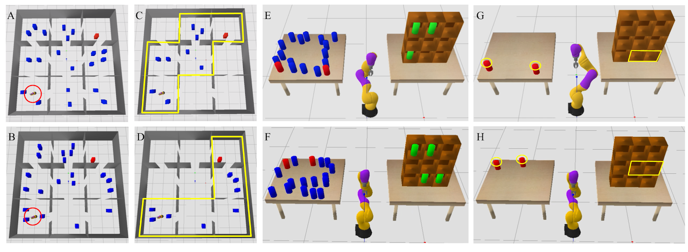
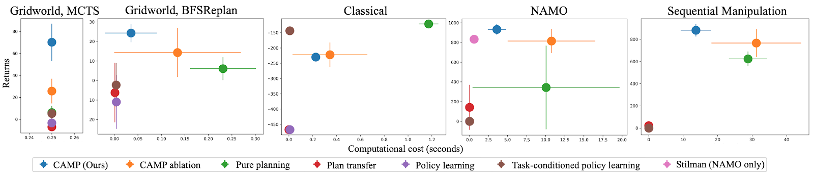

**Back to [Introduction](../2021-03-learning-to-generate-abstractions/)**

**Skip ahead to [Part 2: Learning to Generate Abstractions in Problems with Relational Structure](../2021-03-abstractions-part-2/)**

*Note: this part discusses our work “[CAMPs: Learning Context-Specific Abstractions for Efficient Planning in Factored MDPs](https://arxiv.org/abs/2007.13202),” published at CoRL 2020 [1].*

**Decision-Making in Factored MDPs**

In our pursuit of approaches that will allow a robot to make good decisions quickly, we first consider problems that can be modeled as factored Markov Decision Processes (MDPs). A (discrete-time) MDP consists of a state space, an action space, a transition model, and a reward function. At any given time, the environment will be in a particular state, the robot will decide on an action to take, the state will change according to the transition model, and the robot will be given a scalar-valued reward based on the reward function. The robot’s objective is to take actions that maximize the sum of rewards it obtains. A *factored* MDP is a particular kind of MDP where states and actions can be factored into a set of variables [2]. For instance, a single state variable might be “the current location of the laundry detergent,” and another might be “the color of the living room couch.” The complete state of the environment in a factored MDP is described by an assignment of values to all the state variables, e.g., a precise specification of the current location of the detergent and the color of the couch.

The factored MDP is fully known to the robot. The robot can, for example, imagine taking different possible sequences of actions and anticipate the resulting future states and rewards. A pure planning approach would have the robot do exactly this: ponder many different sequences of actions before ultimately deciding on actions to take in the environment. In contrast, a pure learning approach would have the robot consolidate previous experience (“in the factory”) on similar factored MDPs into a reactive *policy*, which will immediately produce actions in the new factored MDP (“a task in someone’s house”) without needing to plan. We would like an in-between approach that *learns* from previous experience in similar factored MDPs to *plan* effectively and efficiently in the new factored MDP. For our purposes, the word “similar” refers to factored MDPs that share the same state space, action space, and transition model, but may have different reward functions.

There are many approaches to planning in factored MDPs. We aim to develop algorithms that are agnostic to the particular choice of planner for the task at hand.

**Building Projective Abstractions by Dropping Irrelevant Variables**

How should we use past experience to make good decisions quickly in a new factored MDP? In this work, we use previous experience to learn what state or action variables in the factored MDP can be safely ignored during planning. One type of variable that can be safely ignored is an *irrelevant* variable. We say, informally, that a state or action variable is irrelevant if it is independent from all the possible rewards the robot could obtain under a given task, either now or in the future, *no matter what the robot does*.

By this definition of irrelevance, it should be clear that we can simply remove, or *project out*, irrelevant variables from our MDP, and the optimal solution is unaffected: the robot should still take the same actions, since removing irrelevant variables does not affect its rewards in any way. Planning in the resulting *abstract MDP* will often be much faster than planning in the full MDP containing all variables; thus, constructing and planning in such a reduced model is a way for the robot to make *good decisions quickly*.

Unfortunately, this definition of irrelevance is usually too strong to be useful: for any variable, it is conceivable that there is *some way* the robot could act to force that variable to be relevant for a task, even if it really shouldn’t be. Perhaps, when tasked with making dinner, the robot considers knocking over the laundry detergent and then spending an hour cleaning it up. This would greatly delay its ability to make dinner on time, and is certainly not a useful train of thought for the robot to pursue while planning.

**From Self-Imposed Constraints to Contextual Irrelevance to Better Abstractions**

Toward a better notion of irrelevance, we propose that the robot should self-impose a *constraint* on the states and actions that it would be willing to consider for a particular task. For example, when asked to make dinner, the robot might decide to impose on itself the constraint: “I’m going to stay in the kitchen the entire time.” We emphasize that these constraints are *not* enforced by the environment or the designer: they are constraints that the robot imposes *on itself* for the sole purpose of making planning more efficient.

Our main insight in this work is that self-imposed constraints allow us to soften our notion of irrelevance into that of *contextual irrelevance*: instead of saying that a variable is irrelevant when it cannot affect rewards no matter what the robot does, we can now say that a variable is irrelevant when it cannot affect rewards *as long as the robot obeys the constraint it has imposed on itself*. If the robot forces itself to stay in the kitchen while making dinner, all the objects outside of the kitchen, such as the laundry detergent and the couch, become irrelevant because there is no longer any way that they could possibly affect the robot’s behavior. In the paper, we formalize contextual irrelevance using the notion of context-specific independence [3].

As a bonus, well-selected constraints can directly speed up planning: they allow the robot to not waste time considering actions that would violate the imposed constraint. If the robot forces itself to stay in the kitchen while making dinner, it does not have to consider states outside of the kitchen, nor any actions that would only be relevant outside the kitchen (such as driving a car), cutting down on the space of possible plans that it needs to think about.

As before, we can construct an abstract MDP that removes contextually irrelevant variables, while enforcing that states and actions obey the self-imposed constraint. However, unlike before, this abstract MDP is tied to the particular choice of constraint! To emphasize this, we call it a “CAMP,” short for Context-specific Abstract MDP.

Let’s look at some examples of constraints and the resulting CAMPs in actual robotics problems of interest.

**Navigation Among Movable Obstacles (NAMO)**

Consider the Navigation Among Movable Obstacles (NAMO) problem visualized below from an aerial view. A robot starts out at the bottom left and must navigate to the red block in the top right. The robot’s path is littered with blue obstacles. However, these obstacles are movable: the robot can pick them up and place them elsewhere to move them out of the way. This problem is challenging from a planning perspective because it involves many discrete choices (“Which obstacles should I pick and place, and in what order?”) and important continuous choices (“What path should I follow while moving?”).

<video src="../../media/blog/2021-03-abstractions-part-1/figure.mp4" autoplay loop muted playsinline></video>

A useful constraint to self-impose in this NAMO problem would be: “I’m only going to stay in certain rooms,” namely, the ones highlighted in yellow in the above animation. This constraint makes all of the variables pertaining to obstacles outside of those rooms contextually irrelevant! So, we can remove those variables from the planning problem, and efficiently find a plan that works well in the full problem, visualized below.

<video src="../../media/blog/2021-03-abstractions-part-1/figure-2.mp4" autoplay loop muted playsinline></video>

**Sequential Manipulation**

Consider now the sequential manipulation problem visualized below. The robot’s goal is to place the two red objects on the left table into the shelves on the right. In doing so, the robot must be mindful of the blue and green objects, which may cause collisions if the robot is not careful about how it grasps and where it places the red objects.

One useful constraint to self-impose is: “I’m only going to use top-grasps when picking up the red objects from the starting table.” Committing to a top-grasp will force the robot to regrasp the object before placing it into the shelf, since an object must be side-grasped in order to place it into the shelf. This regrasp requirement implies that the plan will be longer than it might be if the robot simply side-grasped the red objects from the starting table, but there is an important benefit of committing to a top-grasp. In particular, this constraint makes the blue objects contextually irrelevant, because it removes the risk of the robot’s wrist inadvertently colliding with the blue objects. Another useful constraint to self-impose is to only consider placing into shelves that are not currently occupied by the green objects, which further reduces the problem by making the green objects contextually irrelevant.

<video src="../../media/blog/2021-03-abstractions-part-1/figure-3.mp4" autoplay loop muted playsinline></video>

After planning in the CAMP induced by the constraints visualized above, the robot finds a plan that works well in the full problem. Note the regrasp that occurs before each red object is placed into the shelf.

<video src="../../media/blog/2021-03-abstractions-part-1/figure-4.mp4" autoplay loop muted playsinline></video>

**Learning to Self-Impose Constraints**

We have seen how a good self-imposed constraint can lead to contextual irrelevance, which in turn leads to a CAMP, and finally, to effective and efficient planning. But how should the robot figure out which constraint is the right one to self-impose? This is an important question because a poorly selected constraint can make the planning problem infeasible, or lead to very low-reward solutions. It is crucial that the robot is able to answer this question for itself, because the right constraint will vary with each new problem. For example, consider the figure below, which shows different problem instances in the NAMO and sequential manipulation domains; note how each problem demands a different constraint.

<em>A good constraint for the NAMO problem in (A) is shown in (C). That same constraint would work poorly for the NAMO problem in (B) because the respective rooms are filled with obstacles. A better constraint for (B) is shown in (D). Similarly, the shelves selected for the sequential manipulation problem in (E), which are shown in (G), would be a poor choice for the problem in (F), because those shelves are occupied in the new problem. A better constraint for (F) is shown in (H).</em>

To select constraints, we turn to learning. Our idea is to use previous experience on similar problems to learn a *constraint selector*, which will take in a representation of a new problem (for example, a top-down image of the initial state in NAMO) and output a good constraint to impose. In our experiments, the constraint selector is a neural network, and the set of considered constraints is given by all possible settings of discrete state and actions variables, and their conjunctions or disjunctions (up to some bounds). We train this neural network with supervised learning; labels are generated by evaluating an objective on every possible constraint for every training task, and picking the highest-objective constraint as the target for multiclass classification. This process can be expensive, but it can be performed offline, before the robot is “shipped.” Crucially, the objective used reflects our ambition to make good decisions quickly: it is a weighted sum between cumulative rewards obtained and the computational cost (measured in wall-clock time) of planning.

A second important question that we address with learning is that of finding the contextual irrelevance relationships in a domain: under a given constraint, what state and action variables can be safely removed from the planning problem? We use a Monte Carlo approach that approximates context-specific independence in the MDP by gathering many samples of variable transitions and estimating and comparing the resulting distributions. As before, although this procedure can be expensive, it doesn’t affect our overall objective of making good decisions quickly on *new tasks*, since it occurs “in the factory” before the robot is shipped to people’s houses.

With these learning problems addressed, we now have a complete pipeline for producing good behavior quickly on a new factored MDP (“a task in someone’s house”): select a good constraint for the task using our learned constraint selector, figure out what variables are contextually irrelevant under that constraint, generate the CAMP by removing these variables, and finally, plan in the CAMP to produce actions that work well in the full environment. We can see that this strategy for *learning to plan efficiently* provides us a tradeoff between the two extremes of pure learning and pure planning.

**Experiments and Results**

We evaluated the CAMP approach in several domains, including NAMO and sequential manipulation, and with several kinds of planners, including graph search, Monte Carlo tree search, value iteration, Fast Downward, and a task and motion planner [4]. Among the baselines that we compared against were variations on the two extremes of pure planning and pure learning. For all approaches, we are interested in not only cumulative rewards (“returns”), but also in the computational cost (time) incurred by the approach during decision-making. The plots below show results along these two important axes for all approaches in all domains, where a dot in the upper left of a plot indicates that the approach has made good decisions quickly.

Across all domains, CAMPs do well at optimizing the tradeoff between effectiveness and efficiency. Pure planning is sometimes effective, but often inefficient, and the pure learning baselines are extremely efficient, but usually ineffective (with the exception of the Classical domain, where there is very little variation between problems, and therefore little generalization required from training to test). Check out the paper for further analysis of these main results and some additional experiments.

**Limitations of the CAMP Approach**

There are many limitations of the pipeline we have proposed. Here are a few of the big ones that motivate our follow-up and ongoing work.

1. In both of the learning problems that we considered, we used methods that rely on a *finite space of useful constraints* to consider. We tried to remain somewhat general by considering logical constraints over discrete variables, but in many problems of interest, these constraints would not suffice. For example, in the NAMO problems, suppose we didn’t have the nice partitioning of space into rooms. In that case, we would really like to learn constraints over continuous variables like the robot’s current position. To learn to self-impose such constraints, we would need more powerful learning methods.
2. The problem setting of factored MDPs is limiting from two perspectives. From one angle, factored MDPs are *too structured*: it is too limiting to assume that the world is nicely carved up into individual variables, some of which we can ultimately ignore during planning. It would perhaps be more scalable if we could instead learn, rather than hand-specify, this factorization. Many works in representation learning attempt to do exactly this, so it would be great if we could make use of these methods, but it is unclear whether they would play nicely with CAMPs. From a different angle, factored MDPs are *not structured enough*: they do not allow us to easily generalize what we have learned to problems involving a different set of variables. If problems have object-oriented and relational structure, we would like our methods to leverage it.
3. The method we have discussed generates one abstraction per planning problem. If planning in that abstraction goes poorly, we have no recourse. One could always fall back to pure planning if the solution found in the CAMP is sufficiently poor, but it would be better if there was a way to plan in a different CAMP as a back-up, perhaps one with the original constraint loosened in some way.
4. Another sense in which one-abstraction-per-problem is limiting is that we would really like to be able to generate multiple abstractions *dynamically* throughout the course of solving a single problem. For example, when making a plan to clean the house, we may be able to ignore all objects in the bedroom while cleaning the kitchen, but later we will need to take those into account when we go to clean the bedroom.
5. The abstractions we have discussed are *projective*, meaning that they simply “drop” variables from the full problem. Abstraction is a very general idea and we would like to be able to consider other types of abstractions as well. For example, another type of abstraction could group together states that are close in all variable values, or close according to some metric that is computed using the full state.

In the next post, we discuss our follow-up work on Planning with Learning Object Importance, which addresses some of these limitations, but leaves many of these questions still open.

**Read On: [Part 2: Learning to Generate Abstractions in Problems with Relational Structure](../2021-03-abstractions-part-2/)**

**Back to [Introduction](../2021-03-learning-to-generate-abstractions/)**

**References**

[1] Chitnis, Rohan*, and Silver, Tom* and Kim, Beomjoon and Kaelbling, Leslie and Lozano-Perez, Tomas. “CAMPs: Learning Context-Specific Abstractions for Efficient Planning in Factored MDPs.” CoRL 2020. <https://arxiv.org/abs/2007.13202>
[2] Guestrin, Carlos, et al. “Efficient solution algorithms for factored MDPs.” JAIR 2003.
[3] Boutilier, Craig, and Friedman, Nir and Goldszmidt, Moises and Koller, Daphne. “Context-specific Independence in Bayesian Networks.” UAI 1996.
[4] Srivastava, Siddharth, and Fang, Eugene and Riano, Lorenzo and Chitnis, Rohan and Russell, Stuart and Abbeel, Pieter. “Combined Task and Motion Planning Through an Extensible Planner-Independent Interface Layer.” ICRA 2014.
