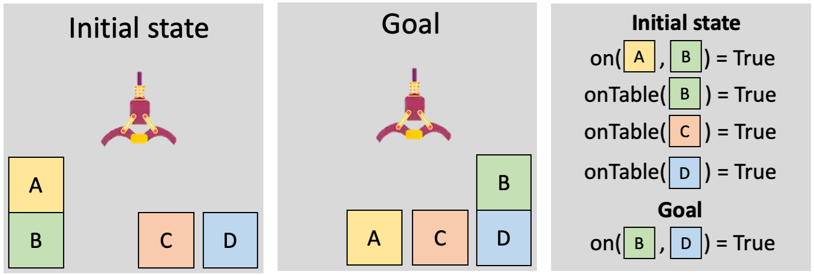
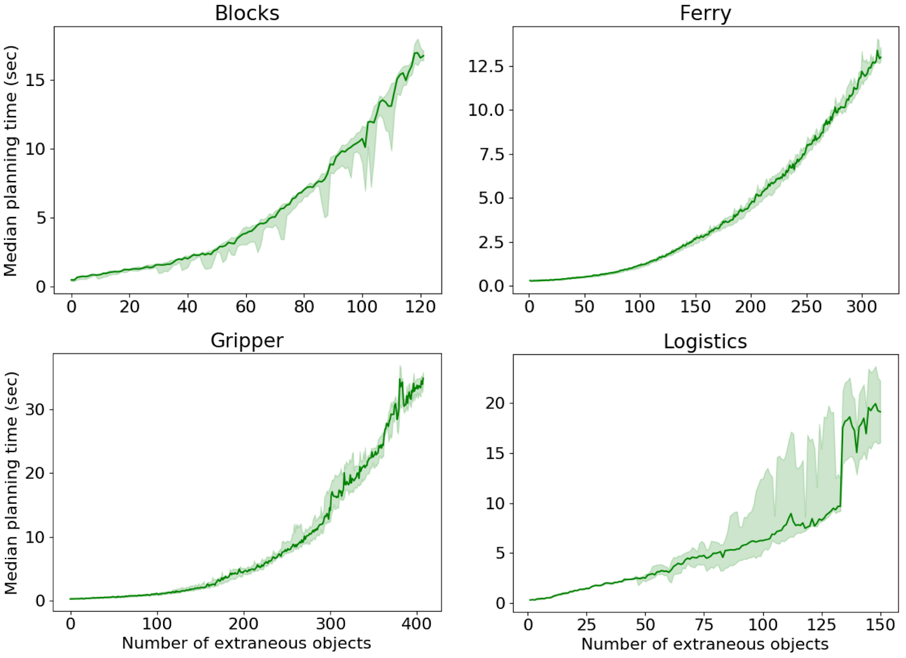
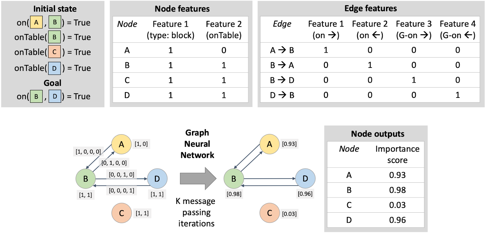
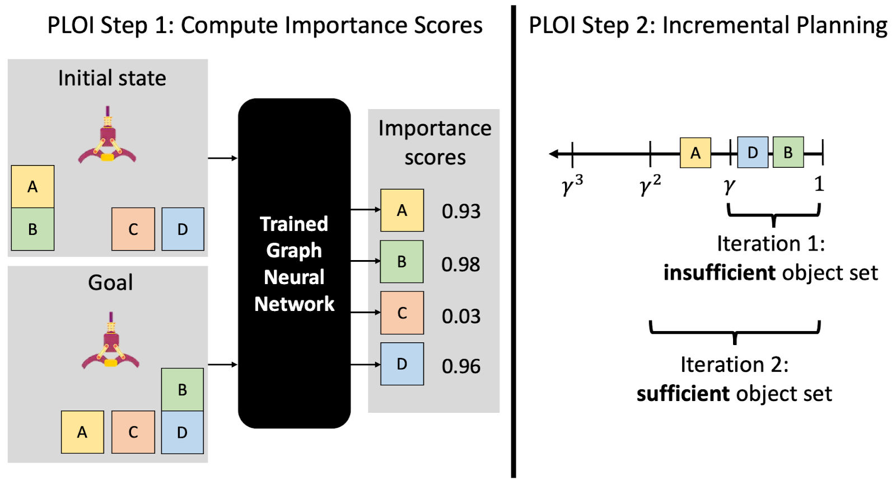
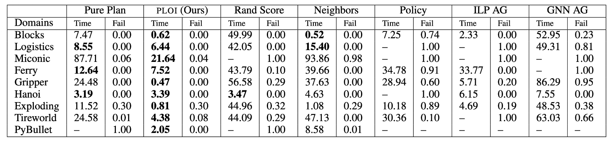
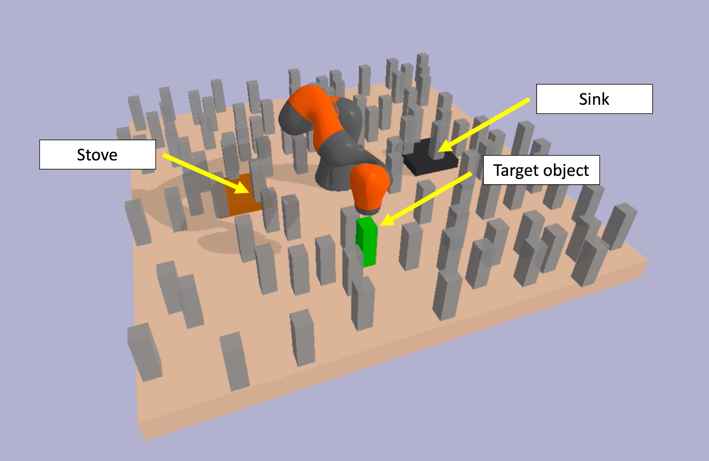

**Back to [Introduction](../2021-03-learning-to-generate-abstractions/)**

**Back to [Part 1: Learning to Generate Context-Specific Abstractions for Factored MDPs](../2021-03-abstractions-part-1/)**

*Note: this section discusses our work “[Planning with Learned Object Importance in Large Problem Instances using Graph Neural Networks](https://arxiv.org/abs/2009.05613),” published at AAAI 2021 [1].*

In the previous post, we saw that CAMPs can be an effective and efficient approach for planning in factored MDPs. However, we also noted several limitations, including the reliance on a pre-specified finite set of useful constraints, the lack of recourse when planning fails, and the inability to exploit object-oriented and relational structure when it exists. In this post, we describe our follow-up work that remedies these limitations, for problems that exhibit relational structure.

**Relational Problem Structure**

First of all, what does it mean for problems to have relational structure? Below is a simple blocks-world problem that will serve as a useful example for the discussion. We have an initial state with four objects — the blocks labeled A, B, C, and D. This initial state can be represented in terms of *relations* involving one or more of the objects. For example, “on(A, B)” encodes the fact that block A is on top of block B; here, “on” is the name of a relation between two objects. To be concise, we represent a state with all the relations that are true; any absent relations are assumed to be false. The goal can be similarly encoded in relational terms, such as “on(B, D)”. All of the problems that we consider in this work have this sort of relational structure, with initial states and goals represented in terms of objects and relations among them. Although the blocks-world example involves discrete values, the methods we discuss here work with continuous-valued relations too, as we’ll show in our robotics experiments later.

In the CAMPs work, we often found ourselves wanting to say that certain objects are irrelevant for a task. Unfortunately, the factored MDP formalism does not involve any notion of objects or their relations, so we had to instead reason in terms of individual state and action variables that pertain to properties of objects, like “the position of obstacle-5.” In CAMPs, therefore, we had to individually decide whether each property of each object was relevant or not, which can be inefficient. Now that this new problem setting exhibits relational structure, we can begin to reason at the level of entire objects: we can say that an object itself is irrelevant, which implies that all its properties are irrelevant. Another advantage is that we can start to think about learning models that will generalize to problems with new and different numbers of objects.

**Sufficient Object Sets**

In CAMPs, we relied on notions of irrelevance and contextual irrelevance to determine what parts of a planning problem we can ignore. Irrelevance was too strong of a property, and contextual irrelevance relied on defining a space of constraints to choose from. In this work, we approach the question of what parts of the planning problem can be ignored in a much more direct way, leveraging the fact that we have relational structure.

Informally, a *sufficient* object set is the smallest subset of objects such that it is possible to find a valid plan using only those objects. The objects that are *not* in the sufficient set are the ones we can ignore, or project out, to create an abstraction of the full problem. For example, in the blocks problem illustrated above, the object subset {A, B, D} is sufficient because we can find a plan that achieves the goal: pick A, put it on the ground, pick B, put it on D. Under this definition, we can safely ignore the extraneous block C.

Our strategy for planning efficiently will be to identify the sufficient object set, use it to create an abstraction of the problem, and plan in that abstraction. Some important questions now arise:

1. Do we actually expect to see meaningful improvements in planning time if all we are doing is removing extraneous objects?

   Planning in relational settings is a very well-studied problem in AI, but even state-of-the-art modern planners cannot cope well with many objects being irrelevant. For example, consider the following plots, which show the time spent by Fast Downward [2] (one of the most commonly used classical planners today) on four standard classical planning domains as a function of the number of extraneous objects that we have added to the problems. These steep curves suggest that we can expect considerable efficiency gains by removing only *some* extraneous objects from the full set.

   

2. Isn’t finding the sufficient object set just as hard as planning?

   In general, yes. However, as noted above, we can greatly improve planning time by even just removing a few extraneous objects. As long as we are conservative with our estimate of the sufficient object set (we don’t decide to throw out objects that we’re unsure about), we should get significant efficiency gains, while not running the risk of making our problem unsolvable under the abstraction.

3. In real-world problem settings, why would there be extraneous objects in our problem representation in the first place?

   Let us answer this question with another question: where are these real-world problem representations coming from? For some applications, the problems may be manually written down by a human engineer, who is smart enough to include only relevant objects in the state representation for each problem. But for the robotics applications that drive much of our work, the state representations are not neatly packaged per problem, and will instead typically be derived from the output of the robot’s perception system. This perception system must identify and track all the objects that may be important for *any* goal given to the robot.

   For example, looking at the cluttered kitchen below, a robot may track the microwave, which would be important for heating up a meal, and the paper towels, which would be important for cleaning the counter. Crucially, the robot’s state will include all of these objects, but once given a *particular* task, the robot may be able to ignore many objects and dramatically simplify the problem. When asked to clean the counter, the robot can ignore the microwave.

So, if we can identify a sufficient object set, we can expect to see large planning efficiency gains on the robotics problems that we care about. So, how exactly can we identify these sets? To answer this question, we turn to learning.

**Learning Object Importance Scores**

As in CAMPs, we will use prior experience on similar problems to learn abstractions of new problems. This time, we will be learning to predict a sufficient object set.

The idea of learning to predict a set directly is daunting because there are so many possible sets that could be predicted; a problem with N objects would give us 2^N possible subsets to choose from.

To circumvent this difficulty, rather than directly predicting a sufficient object set, we will predict *individual object importance scores*. An importance score is a number between 0 and 1, with a higher score indicating that the object is more likely to be included in a sufficient set. After assigning a score to each object individually, we can create an approximate sufficient object set by gathering up all of the objects whose importance scores are above some threshold γ. Although individual object importance scores have their limitations (see the paper for more discussion), we nevertheless find them to be useful in practical planning problems.

We have identified a model that we want to learn: the object importance score function. We must now answer two questions. (1) How do we get data for learning this model? (2) What is the model class? To address (1), we take our set of training problems (the tasks that the robot is given “in the factory”), and for each one, we estimate the sufficient object set with an approximate greedy method that removes one object at a time until planning would no longer succeed if we remove anything else. The resulting subset of objects is sufficient by definition; all of the objects in this set will be assigned an importance score of 1, and all other objects 0. To address (2), we use graph neural networks, which we briefly describe next.

**Graph Neural Networks**

One of the main motivations for turning to this relational problem setting is that we want to be able to generalize to new problems that involve previously unseen objects. To that end, it is crucial that the model we are learning is itself relational. Fortunately, there is a long line of work on relational models that we can draw upon.

In this work, we chose graph neural networks (GNNs) as our basic building block, primarily because of their native support for relations involving continuous values, which we make use of in experiments. A GNN is a neural network that takes in a graph (a collection of nodes and edges) and outputs another graph with the same nodes and edges. The difference between the input and output graphs are the feature vectors associated with every node and every edge.

We want to use GNNs to learn the object importance score function, which will take in a relational initial state and goal, and output an importance score for each object. Given that GNNs map graphs to graphs, all we have to figure out is how to encode our inputs and outputs as graphs. To do so, we let nodes in the graph correspond to objects. To encode relations involving single objects, like “OnTable,” we add node features that are either 0 or 1 depending on whether that relation holds for each object. To encode relations involving two objects, like “On,” we add an edge between the respective nodes and label the edge accordingly. (There are various ways to handle relations that involve more than two objects, but in this work, we considered problems that only have relations involving up to two objects.) The output graph is easy: each node has a single feature corresponding to its importance score. This graph construction is illustrated in the figure below, with more details in the paper.

With the model class established and a dataset collected, we are able to train our object importance score function. Once trained, this function allows us to predict importance scores in a new problem, which we can then use to construct a sufficient object set. To construct an abstraction of the problem, we remove all relations from the initial state that reference objects not contained in the predicted sufficient set. Finally, we plan in this abstraction using an off-the-shelf relational planner like Fast Downward. We refer to this overall method as PLOI: Planning with Learned Object Importance.

**Recourse for Failed Planning Attempts: Incrementally Lowering γ**

There is one more aspect to PLOI that addresses a limitation of CAMPs we discussed earlier. Suppose that when we plan in an abstraction induced by our predicted sufficient object set, we find that either the planner fails to produce a solution, or it produces a solution that doesn’t actually solve the full problem. We would like to have some recourse in this situation.

Recall that we construct the sufficient object set using a threshold 0 < γ < 1 on the predicted importance scores. This setup allows for a natural *incremental planning* strategy, where if at first we don’t succeed, we try again with a larger object set obtained by lowering the threshold. We can repeat this procedure until a valid plan is found, or until we end up with just the full object set. In addition to giving an empirical boost, this procedure ensures that PLOI maintains completeness: if planning in the full problem is guaranteed to result in a plan when one exists, or terminate with failure otherwise, then planning with PLOI will, too. A full example of PLOI, including the incremental planning procedure, is illustrated in the figure below.

**Experiments and Results**

As in CAMPs, the central empirical question in this work is: to what extent can PLOI make good decisions quickly? We will again be concerned with both effectiveness and efficiency (how much time is required by PLOI to generate solutions). Since all of the problems that we consider in this work are goal-based, rather than involving more general reward functions, we can simply measure the fraction of times that an approach produces a plan achieving the goal, as a reflection of the approach’s effectiveness.

We consider a variety of planning domains, ranging from deterministic classical planning domains, to probabilistic planning domains, to a robotic task and motion planning problem implemented in the PyBullet physics simulator. For baselines, we again include the two extremes of pure planning and pure policy learning. We also include two non-learning heuristic approaches and two methods based on recent work; see the paper for details. The full results are shown in the table below.

<em>Full results of PLOI experiments. The first 6 rows are classical planning domains; the next 2 are probabilistic planning domains; the final one is a robotic task and motion planning domain. Classical and probabilistic planning domains use Fast Downward off the shelf (with single-outcome determinization and replanning for probabilistic domains); the task and motion planning domain uses PDDLStream [3] off the shelf. For each method, we report planning time (in seconds) and failure rate within a 120-second timeout. Bolded times are within two standard deviations of being the best. We can see that PLOI performs very well across the board.</em>

PLOI performs very well across the board, achieving the best or tied-for-best planning times, and low success rates. Note that the planning time for PLOI includes not only the time taken by planning in the abstraction, but also the time taken by predicting object importance scores which are used to generate that abstraction.

As mentioned above, one of our main motivations for using GNNs is the ease with which we can incorporate continuous object properties, such as position, bounding box size, mass, and so on. Our experiments in the task and motion planning domain (PyBullet), illustrated below, showcase this ability. This domain features a robotic arm on a tabletop with a target object, a sink, a stove, and many obstacles. The objective is to move the target object to the sink (cleaning it) and then the stove (cooking it). The obstacles make for a difficult planning problem, since the robot must be careful to avoid collisions while picking and placing the target object.

The animation below illustrates the object importance scores predicted by our learned GNN, and the abstraction that results from removing unimportant objects. The GNN has learned to recognize important geometric features; it has learned that objects close to the target object, sink, and stove are important to consider while planning, since they may cause collisions, while farther-away objects are less important.

<video src="../../media/blog/2021-03-abstractions-part-2/figure.mp4" autoplay loop muted playsinline></video>

After planning in the abstract problem, the robot finds a plan that succeeds in the full problem, visualized below.

<video src="../../media/blog/2021-03-abstractions-part-2/figure-2.mp4" autoplay loop muted playsinline></video>

**Discussion**

In this blog post, we have illustrated two concretizations of the central idea of *learning to plan efficiently*. We’ve shown with both CAMP and PLOI that it is possible to achieve a good tradeoff between pure planning and pure learning. Both approaches learn models that can be used to produce abstractions of the planning problem, and then invoke off-the-shelf planners to solve these abstract, simplified problems. Although PLOI addressed some of the limitations discussed at the end of [Part 1](../2021-03-abstractions-part-1/), others remain. How can we generate abstractions dynamically, so that we don’t need to commit to one single abstraction for the entire time that we’re trying to solve a problem? What sorts of abstractions can we consider other than projective ones, and when would they be useful? Is there a way to construct a general, problem-independent space of abstractions that would be useful across all the robotics applications we are motivated by? These are just some of the questions that we hope to keep thinking about in our research agenda.

Ultimately, we are interested in developing an agent architecture that can *learn from limited data* to produce *abstract models* that speed up planning. Both CAMP and PLOI offer ways to instantiate this idea, but require several representational assumptions in doing so. We envision that someday, a robot can learn to convert its raw sensory inputs (e.g., camera images and LIDAR scans) into an abstract representation of the world that affords very fast planning with off-the-shelf planners. This representation could resemble the ones that we saw in this post, or it could be something else — we aren’t sure yet! Regardless of the choice of substrate, we know that as we work toward general-purpose AI, it will be important to draw on the strengths of both pure learning and pure planning approaches, while doing our best to mitigate their respective weaknesses. And then we’ll never have to do our own laundry ever again.

**Back to [Introduction](../2021-03-learning-to-generate-abstractions/)**

**Back to [Part 1: Learning to Generate Context-Specific Abstractions for Factored MDPs](../2021-03-abstractions-part-1/)**

**References**

[1] Silver, Tom*, and Chitnis, Rohan* and Curtis, Aidan and Tenenbaum, Josh and Lozano-Perez, Tomas and Kaelbling, Leslie. “Planning with Learned Object Importance in Large Problem Instances using Graph Neural Networks.” AAAI 2021. <https://arxiv.org/abs/2009.05613>
[2] Helmert, Malte. “The fast downward planning system.” JAIR 2006.
[3] Garrett, Caelan Reed, and Lozano-Perez, Tomas and Kaelbling, Leslie. “PDDLStream: Integrating symbolic planners and blackbox samplers via optimistic adaptive planning.” ICAPS 2020.
