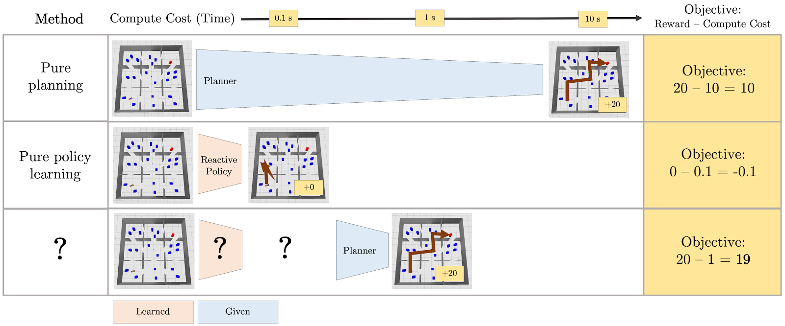

**Introduction**

One day, we would like to have robots that live in our houses and do all of the chores that we would rather not do: laundry, cooking, installing and fixing appliances, taking out the trash, and so on. When someone gives one of these robots a task, like “make me pasta!”, they’ll want the robot to perform the task *effectively* and *efficiently*. They would be unhappy to receive a bowl full of trail mix or toothpaste or nothing at all; that would be ineffective. They would be similarly disappointed to watch the robot remain motionless for hours as it ponders how to complete the task before it, as though it were asked to prove P != NP; that would be inefficient. What we really want is for our robots to *make good decisions quickly*.

As researchers trying to prepare our robot for household duties, we can imagine a spectrum with two extremes: “pure learning” and “pure planning.” The pure learning extreme would have us train robots in the factory, before they are ever shipped to people’s houses, on an enormous number of decision-making problems that hopefully resemble the ones it will encounter later on in those houses. We would compile this training experience into a fast reactive policy so that the robot can respond to tasks like “make me pasta!” without any hesitation. While such a policy would be ideal if we could learn it, the main difficulty with pure learning is generalization: will the robot have seen enough training data to effectively respond to every possible task variation that it might see in any possible house?1 Often the answer will be no, resulting in a robot that makes *bad decisions quickly*.

On the other end of the spectrum is pure planning, which would have the robot reason about possible sequences of actions (plans) that it could take whenever given a new task, with no learned bias or guidance. While planning for the task of making pasta, the robot may consider whether it should boil water (which would be useful for the task) or interact with the laundry detergent (which would not be useful). Typically, there will be many more of the latter type of action — ones that are not useful to think about when trying to plan out how to solve a particular task. If the robot’s model of how the world works is good, and its planner is sound and complete, then it will eventually find a plan that solves the task, with emphasis on “eventually”: the robot will make *good decisions slowly*.

<em>In large and complex decision-making problems like navigation among movable obstacles, planning may make good decisions slowly (first row), while a learned reactive policy may make bad decisions quickly (second row). We want to find a sweet spot (third row) between learning and planning that will allow us to make good decisions quickly.</em>

In our recent work, we consider strategies for effective and efficient decision-making that lie between the two extremes of pure learning and pure planning. Our main idea is to *learn to generate abstractions of problems that afford faster planning.* The abstractions we consider are projective, meaning that they ignore certain parts of the full problem. As an example, a good projective abstraction for making pasta would ignore irrelevant objects for that task, like the laundry detergent. In the remainder of this post, we describe two concretizations of this idea, one appropriate for decision-making tasks that can be modeled as factored Markov Decision Processes (MDPs), and another that is useful for settings where states have object-oriented, relational structure. We include throughout a discussion of the many limitations of these works and point out a few important questions that must be answered before we can feel comfortable inviting robots into our homes.

**Read On**

[**Part 1: Learning to Generate Context-Specific Abstractions for Factored MDPs**](../2021-03-abstractions-part-1/)

**[Part 2: Learning to Generate Abstractions in Problems with Relational Structure](../2021-03-abstractions-part-2/)**

**Acknowledgements**

Thanks very much to Aidan Curtis, Sahit Chintalapudi, and Leslie Kaelbling for providing extremely helpful feedback on an earlier version of this post.

1Throughout this post, we are assuming that the agent is equipped with a good model of how the world works. Therefore, “pure learning” should be understood more as policy compilation, e.g., by treating the model as a simulator, rather than reinforcement learning. Both ends of the spectrum, pure learning and pure planning, make use of the model.

2The term projective comes from the fact that we are projecting factored states and actions onto subspaces by removing certain dimensions (See Konidaris, George Dimitri, and Barto, Andrew G. “Efficient Skill Learning using Abstraction Selection.” IJCAI 2009).
