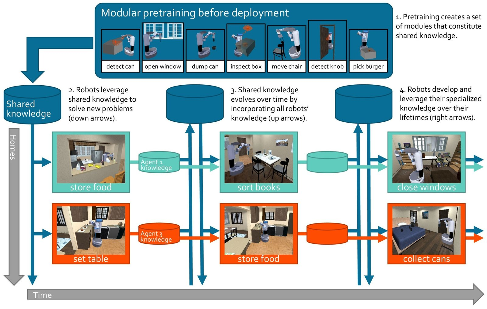
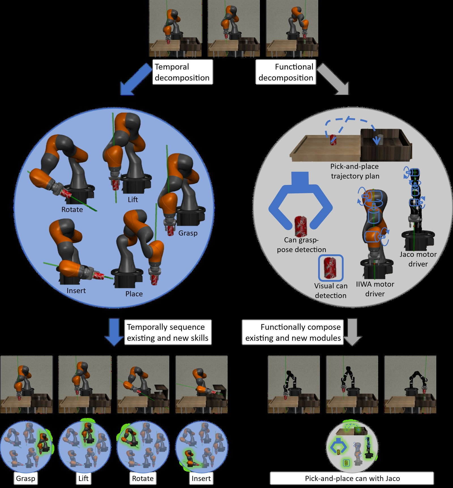
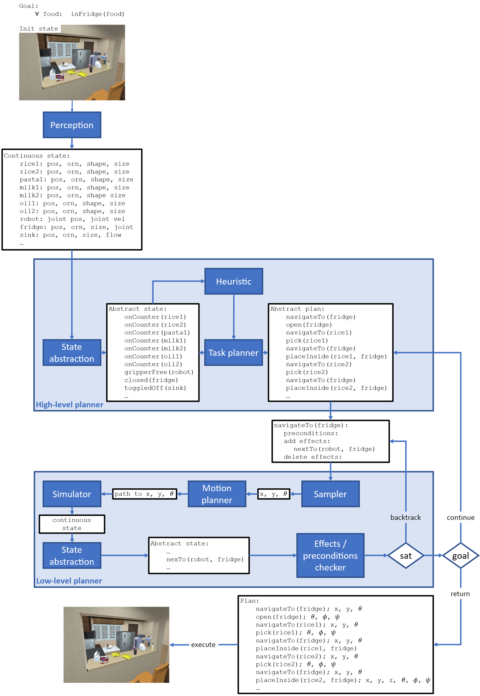

Embodied intelligence is the ultimate lifelong learning problem. If you had a robot in your home, you would likely ask it to do all sorts of varied chores, like setting the table for dinner, preparing lunch, and doing a load of laundry. The things you would ask it to do might also change over time, for example to use new appliances. You would want your robot to learn to do your chores and adapt to any changes quickly.

**As we will see, the fact that the learning agent is a robot transforms the lifelong learning problem, making it a) unique and b) tractable.** Most significantly, compared to other domains like language or vision, we have plausible mechanisms for solving robotics problems by decomposing them—for example, *task and motion planning* (TAMP) methods break problems down into multi-step plans and multi-stage processing pipelines. These various forms of modularity will allow the robot to construct much simpler lifelong learning problems for itself and generalize compositionally, while its ability to explore will enable it to collect increasingly high-quality data as it becomes more capable. In addition, the agent will be able to leverage domain knowledge about physics and geometry both to ground information in the physical world and as sanity checks of the robot’s own ability to understand the environment.

We will start by seeing why other (non-lifelong) forms of learning are insufficient for this embodied setting, and how embodiment leads to a special form of lifelong learning. Next, we will dissect three facets of the embodied lifelong learning setting: a single robot learning over time to assist its user, a collection of home assistant robots sharing knowledge, and a large-scale pre-training setting to bootstrap future lifelong learning. As illustrated in Figure 1, these three aspects of the problem naturally interact in a large-scale learning system that will facilitate the broad deployment of embodied agents.

> **Figure 1:** A large set of modular abilities is pre-trained with large-scale (real and simulated) data. The pre-trained modules are then used as a starting point for a multitude of home assistant robots, which 1) improve their own knowledge and specialize it to the individual needs of their user and 2) propagate any new knowledge to the shared system for other robots to leverage.

## Why can’t we just pre-train a large robot model?

There are a few different ways we could consider training your home assistant robot via machine learning.

1. We could treat each new chore as an isolated task and train a machine learning model to solve it (say, via reinforcement learning)—this is the *single-task learning* paradigm. Single-task training would be very wasteful: your robot would disregard anything it had learned in the past (about your home, about plates, about physics…) and start its learning anew for each individual request.
2. We could train a single system jointly on all chores, which could in many cases be more data-efficient due to the commonalities across the various chores—this would be the *multitask learning* paradigm. This latter approach is impractical, since we cannot know ahead of time what all those chores will be.
3. If the reader has been following the recent trends in machine learning, they might immediately think of *large-scale pre-training* as a promising direction to solve our embodied intelligence challenge. And indeed, pre-training will very likely be a key element of the solution to this problem. Yet, sadly, it is unlikely to be sufficient on its own.

   Pre-training assumes that the data distribution is *stationary* (that is, unchanging with time). But the world is inherently *nonstationary*: humans’ preferences and requirements change over time, physical environments change over time (appliances are updated, furniture is moved, homes are remodeled…), robots are moved (to new homes), and robots’ own capabilities change over time (degrading motors, upgraded sensors, additional actuators…). If we use massive amounts of data to train our robots today hoping that the learned models will be perennially useful, the limitations of our robots are bound to become increasingly more apparent as the world transforms around them.

   But even if we assume that the world is stationary and your robot might learn a model that covers all requirements it will ever deal with, pre-training alone might still fall short. Even the world’s most advanced pre-trained language models today (such as GPT-4) often fail; it would be unreasonable to expect our pre-trained robot models to be flawless. The possibility of robots receiving continual feedback (both from humans and from the environment) creates an opportunity to *correct* these failure modes over time.

   In essence, much like we have learned that we can’t *program* solutions to every problem a robot might ever face, evidence suggests that we cannot *pre-train* a robot to be prepared for all its future endeavors. So, while we will surely want to leverage the (massive) power of pre-training, *pre-training will not suffice on its own*.

So single-task machine learning, multitask machine learning, and large-scale pre-training are not by themselves appropriate. **If we want our robots to be useful for long stretches of time, we have no choice but to deal with the underlying lifelong learning problem.** In this lifelong setting, the robot must acquire knowledge about its environment, the types of chores that it needs to perform, and its own abilities *online in the field*. If we solve this (monumental) challenge, we will have robots that accumulate information over time, incrementally improving their overall capabilities. Such robots could then leverage their accumulated knowledge to very efficiently handle new requests and new *types* of requests via compositional generalization.

## How the modularity of embodied agents transforms the lifelong learning problem and why that matters

Two key properties that will facilitate lifelong robot learning are *modularity* and *compositionality*. These characteristics will enable the learning agent to reuse knowledge in a multitude of ways, acquire new knowledge without interfering with previous knowledge, and even define its own learning tasks.

While there has been much progress in (disembodied) lifelong learning, we are still far from the kind of knowledge accumulation and reuse that we would want from true lifelong learners. Most generally, a lifelong learner faces a never-ending stream of arbitrarily (un)related data points; practical formulations assume that experience is organized into data sets, each drawn *i.i.d.* from some data distribution. Each such distribution is a *task*, and tasks are presented in sequence, drawn from some (potentially nonstationary) task distribution. Even in this simplified setting, the agent faces the major challenge of discovering arbitrary commonalities (and discrepancies) across tasks.

In the embodied setting, the key leverage available to us is that some of our existing mechanisms for solving robot problems break them down into parts, both at the *temporal* and the *functional* levels—notably, we do not have such a clear understanding of how these forms of decomposition apply to disembodied agents. While embodied agents will also face a continual stream of data and objectives, **we will very explicitly not treat each of these objectives as a learning task**. Instead, the robot itself will devise learning tasks that are amenable to lifelong training.

The first reason we want to consider this type of decomposition is twofold: each individual problem the robot will likely face can be extremely difficult to learn as a single machine learning task. First, the long-horizon nature of many real-world robot objectives necessitates strategizing over many steps. Second, the complicated functional relation between sensory inputs and motor outputs calls for highly abstract reasoning. Training one end-to-end model to handle just one of these two requirements is notoriously difficult; doing so for both requirements is likely to fail. Handling, on top of that, the diversity of objectives that your long-term robot assistant will face is simply hopeless.

The second reason, which more specifically ties to our continual deployment setting, is that large, uninterpretable machine learning models are just a poor fit for lifelong training. Imagine we have trained a single end-to-end neural net—the standard lifelong learning solution today—to solve two household robot chores: setting the table and preparing dinner. If you then ask your robot to do the dishes, how could we expect it to know what parts of its existing network are useful for doing dishes? And how could we expect it to adapt its big network of weights to account for this new chore? Learning models that are *compositional* would allow us to put together elements of previous solutions, like plate detection and cutlery manipulation. Learning models that are explicitly *modular* would also allow us to add new pieces, like soaking a sponge or wiping the dishes dry, without the need to edit the entirety of the robot’s body of knowledge.

## Problem setting 1 — Home assistant robot learning modular knowledge on the fly

Let’s dig deeper into the problems that arise in embodied lifelong learning, continuing with our household robot example. Assume that when you purchase a robot, it will come equipped with some basic capabilities, like object detection, some level of state abstraction (like the ability to tell that a plate is on the table, relationally), and some set of motor skills (such as navigating from A to B, or picking-and-placing simple objects). You will continually ask the robot to do chores for you, and its goal will be to perform the chores as efficiently as possible. If the robot has never done a particular chore, you might demonstrate how to accomplish it, or the robot might explore solutions and learn from its own experience.

**This formulation lacks any separation between a "training" phase and a "test" phase: the robot is perpetually attempting to help you.** One implication of this is that all data the robot encounters is available for improving its knowledge, and this improvement will be (implicitly) tested in each subsequent chore the robot attempts. Also note that there is no restriction that the robot should treat each "chore" as a "task" in the traditional lifelong or multitask sense. Instead, the robot might devise its own tasks as machine learning problems that yield models that are useful for some aspect of the chore (instance detection, parameter estimation, dynamics prediction…).

The usual lifelong learning problem presents the system with machine learning tasks in sequence, and later evaluates the system on all learned tasks to measure its ability to retain knowledge. A frequent debate among lifelong learning researchers is whether this formulation in terms of knowledge retention is appropriate. The main argument for is that it is a simple and practical formulation, and therefore actionable: we know how to develop and evaluate methods for their ability to avoid forgetting after training over a sequence of tasks. The primary argument against is that the formulation is too unrealistic, and potentially misleading: progress toward solving the problem of knowledge retention in this context may not lead to the kind of lifelong robot learners we would eventually want to have in our homes. In particular, agents in the real world are not faced with isolated machine-learning tasks that they need to solve, but instead confront problems that require solving multiple machine-learning tasks in intricate combinations. For example, your robot will never be just in charge of recognizing a plate in front of it or detecting whether your chicken is cooked; instead, it will need to combine these (and other) skills to prepare dinner.

The embodied formulation above—an agent continually evaluated over objectives that are distinct from its learning tasks—bridges between both sides. Clearly, evaluating a robot for its ability to handle a user’s requests is realistic, yet *training* the robot directly to handle user requests would probably be impractical. In particular, it seems infeasible to train a robot over a sequence of complex user requests and evaluate it on future requests. In our formulation, when a robot is handling a request such as cleaning the table, it must solve a multitude of subtasks (detect cutlery, make a plan, navigate to the table…). A practical solution would treat each of these subtasks as a learning task, leveraging the standard lifelong *training* setting (a sequence of isolated machine learning tasks), but maintaining the more realistic *evaluation* over the user’s requests. In other words, while (practical) machine learning tasks are too artificial as evaluation targets, they are certainly real (and useful) as optimization targets.

### Opportunity 1.1 — Modularity and compositionality

This brings us to the first opportunity that existing approaches to embodiment afford lifelong learning: modularity and compositionality. The key notion is that the robot can decompose each *problem* (or household chore) it faces into a set of (machine learning) *tasks*. As a consequence, whenever multiple different problems share common tasks, the robot can reuse the solutions to (and data for) the mutual tasks across the problems. Let’s take as an example a robot in charge of two chores: doing the dishes and setting the table. The visual plate detection task can be learned with data from either of the problems, and as soon as the model improves with data from one of them, it becomes more powerful for the other. Another critical implication is that, in the lifelong setting, the agent would not need to update its entire body of knowledge to learn to solve a new problem. In common lifelong learning solutions, the agent learns a single, monolithic model to solve all problems it will face. So an agent that has learned to do the dishes would need to update the whole of this massive monolith to learn to set the table, even the parts of the solution that bear no relevance to table setting, such as soaking a sponge or wiping plates dry. Instead, a modular learner would only need to update any *relevant* knowledge, leaving other parts of the model untouched.

The key question, then, is how to decompose problems into learning tasks. TAMP systems decompose problems along many axes; we focus primarily on functional and temporal decompositions, illustrated in Figure 3.

> **Figure 2:** Functional vs. temporal composition of robot decision-making policies. The policy to pick-and-place a can with a KUKA iiwa arm is decomposed along a temporal or a functional axis. Temporally extended actions correspond to skills, such as grasp, lift, or place, which are transferable to a place-on-shelf task with the KUKA iiwa arm. Functional components correspond to processing stages, such as grasp-pose detection, trajectory planning, or motor control, which are transferable to a pick-and-place task with a different arm, like a Kinova Jaco. Temporal modules are active one at a time, while multiple functional components activate simultaneously.

A *functional* decomposition separates the problem into modules that perform computations on their inputs to produce an output that serves as input to other modules. This type of decomposition is pervasive in robotics, where typical processing pipelines involve perception, task planning, obstacle avoidance, trajectory planning, and motor control. A learned functionally modular solution can then range from a modular neural net to a more explicit neuro-symbolic program. One key design choice is how modules will "speak" to each other, and whether this "language" (or interface) will be programmed by a human or learned. For example, one common way for perception systems to talk to planning systems is by outputting an object-level, relational description of the scene. However, it is plausible that a *learned* abstraction may be more appropriate if we don’t know a priori what information is most relevant for describing a scene to a planner.

One appeal of human-designed interfaces is that they enable communication between learned and programmed modules. A major implication of this is that a human can write all safety-critical modules (like obstacle avoidance) and let the agent autonomously learn the remaining modules (such as functional grasping). More generally, this type of functional modularity enables us to improve the safety of deploying physical robots in users’ homes by 1) regulating how much knowledge is acquired autonomously by the robot versus how much is provided by humans and 2) increasing the explainability of the learned models.

A *temporal* decomposition splits the problem into modules that perform actions to transform the state of the world into one in which subsequent modules can act. A temporally modular solution would then solve each problem via actions that can be executed in sequence to reach the goal. A popular example approach to temporal decomposition is the options framework for hierarchical reinforcement learning, where each *option* represents a module.

In addition to these two forms of modularity, the agent could decompose its learning in various other ways—which we will not dive into, but that have similar implications for lifelong learning: factoring the effects of actions into object relations (picking an object results in the object no longer being on its previous surface, the object being held, the robot’s gripper being occupied…), independently determining how to execute an action for each object type (moving a sofa versus moving a basketball), separately planning for achieving disjoint objectives (bring you coffee AND clean the table)…

To make things more concrete, let’s go into some of the ways in which TAMP approaches are functionally and temporally modular (illustrated in Figure 3), and the kinds of learning tasks that arise from this modularity.

> **Figure 3:** Example TAMP system—simplified search-then-sample. A robot starts in some initial state and is asked to satisfy some goal. The continuous state is estimated from sensory input, abstracted into a set of predicates, and used by a task planner (say, Fast Downward) to generate an abstract plan consisting of STRIPS-like operators (with preconditions and effects). The low-level search samples continuous parameters for a motion planner, simulates the outcome of the planner at the continuous level, and checks that the intended effects are attained (at the predicate level). The overall system performs backtracking search at two levels: if many samples fail to achieve one action’s effects, backtrack and try a new sample for a previous action; if the overall abstract plan fails to be refined, backtrack and try a new abstract plan.

1. The planning system is made up of multiple functional components: a task planner that determines a sequence of abstract actions that, given an initial abstract state, achieve a desired abstract goal; a heuristic function that prioritizes abstract plans within the task planner; a perception system that, given a sensory observation, produces an abstract state that describes the world in terms that are understandable by the task planner; a motion planner that, given a single abstract action and a set of continuous parameters, devises a continuous-level plan for the robot to execute; a continuous parameter generator that, given a continuous-level state, generates the parameters for the motion planner. This decomposition can result in a learning task that discovers domain-specific heuristics that improve planning efficiency, another that learns a distribution of promising continuous parameters to generate samples for the motion planner, another that discovers a policy via reinforcement learning to produce motion plans, another that learns a mapping from image observations to object relations that describe a state abstractly…
2. The plans consist of temporal sequences of modular actions: navigate to fridge → open fridge → navigate to rice 1 → pick rice 1 →… Each of those actions in turn is represented internally in the planner in terms of modular preconditions (pick rice 1 requires the robot to be near the rice, the robot’s gripper to be free, the rice not to be blocked…) and effects (pick rice 1 results in the gripper not being free, the rice being held…). Some of the functionally modular learning tasks described in point 1 (concretely, the parameter sampler learning and the motion plan policy learning) can be further decomposed temporally, such that we learn a sampler and a policy for navigating to an object, a separate sampler/policy for picking, another for placing…

In this way, the robot can construct a number of simpler learning tasks for itself, and carry out the lifelong training separately (without interference) for each of those tasks. As the robot becomes more capable, it can acquire new modules over time to handle new, perhaps more difficult problems. Note that each learning task itself would still be a lifelong learning problem, with data being continually fed into the model for training. But

1. no model would be single-handedly responsible for the performance of the system,
2. the model trained for solving each task would be simpler than a monolith to solve entire decision-making problems,
3. the data distribution for training each module would likely be narrow, since it would correspond to a single task as defined by the learner itself.

**Critically, for other learning domains, such as vision and language, we do not know of such successful approaches that are modular.** Part of the success of modular robot approaches stems from the fact that planning systems can provably guarantee (probabilistically, in many cases) the solution to (some) problems, unlike modular solutions in other domains.

Note that, while modularity is useful for generating easier learning problems, monolithic or end-to-end learning often leads to higher-quality solutions in settings where data is abundant—at the very least, these solutions can be more efficient to execute online. To bridge this gap, our modular learners could train special "bypass" policies that summarize the behavior of a combination of modules in an end-to-end fashion when sufficient data is available. Given an existing modular solution, these bypass policies could be trained via a form of self-imitation.

### Opportunity 1.2 — Active exploration

Another consequence of the embodied decision-making setting is that the agent controls the process of data collection. This contrasts with the typical supervised setting of most lifelong learning literature. The distinction is critical: there’s intuitively a small bound in the performance difference between two (reasonable) algorithms trained on the same pool of data. In other words, there’s only so much we can do algorithmically to improve the performance of a learning agent given a fixed data set. Indeed, this well-known lesson has promoted the use of increasingly larger training sets, giving rise to today’s famous large-scale models. As a result, the use of one fixed data set limits the performance improvement of a lifelong learning algorithm over a single-task algorithm. But a similar story could be told about data *quality*. Undoubtedly, out of two (reasonable) systems trained on distinct data sets of the same size, the system trained on the better data set will be better.

Consequently, the potential of an embodied lifelong learner, capable of collecting its training data in a manner of its own choosing, goes beyond what a disembodied lifelong learner could achieve. A clear example of this is the difference in published results in supervised versus reinforced lifelong learning; the latter tend to show substantial improvements over single-task learners, whereas the former struggle to even match the single-task performance. (Note that part of this difference also stems from the often nonexistent similarity between supervised tasks used for evaluating these methods.) While lifelong reinforcement learning methods also suffer from the typical pitfalls of lifelong supervised learning (catastrophic forgetting, lack of adaptability), they compensate for these shortcomings by collecting higher-quality data thanks to their ability to transfer exploration policies from previous tasks.

This capability is not limited to reinforcement learners: it extends to any agent that is free to make queries (to the world by acting on it, or to a human by asking them) on data of its own choosing. In particular, agents can leverage this intuition by making decisions on which data to query (which actions to take, or which data points to request feedback on) informed by the knowledge that they have accumulated from previous training. This can for example be done via query policies that optimize for novelty of the outcomes or even more explicitly for future learning.

## Problem setting 2 — Sharing modular knowledge across a cluster of home assistant robots

Given mechanisms to accumulate knowledge over a robot’s lifetime in a home, a natural direction to scale up the capabilities of the robot is to accumulate knowledge across multiple robots in multiple homes. For example, if your robot has learned to make coffee, my robot could leverage this knowledge and immediately know how to make coffee as well. Of course, I would want my robot to learn to make coffee *how I like it*, and not how you like it (and to do so in my home, with my appliances, with my ingredients, with my setup…). We want the knowledge of each robot to be specialized to its user’s preferences and home. Also critically, this sharing of knowledge between robots shouldn’t allow me to learn information about your private life.

The latter point about privacy is worth delving into. Differential privacy has become the standard formulation for guaranteeing that an external agent cannot leverage a published model to gain knowledge about an individual whose data was used to train the model. Somewhat more concretely, differential privacy guarantees that two randomized models trained on data sets that differ by a single data point have similar outcome distributions. This highlights a first challenge: adapting differential privacy to the lifelong robot learning setting requires a similar guarantee *across all data from an individual*. Another, greater difficulty is that differential privacy degrades with the number of queries to an algorithm. The limitless time horizon of the lifelong setting implies that there is no bound on the number of queries to the algorithm, making it unclear how to apply existing results.

### Opportunity 2.1 — Massively increased data

The first opportunity is trivial, yet it is potentially so powerful that we would be remiss if we failed to mention it. The more ubiquitous home robots become, the more data can be shared across them, and the more general their capabilities will become. And of course, the more users whose data make up that model, the less sensitive the model becomes to any individual user.

This last point somewhat contradicts the previous one regarding the number of queries, so let’s clarify the distinction. Briefly, if all users were added at one time, the algorithm could release a single version of the model, and privacy would be strong due to the large volume of users. However, in the lifelong setting, the algorithm may release incremental versions of the model, each revealing a small bit of additional information about users. The more users are incrementally added, the more queries will be made to the model. Reconciling this contradiction would be a crucial step toward sequential private data sharing across a multitude of robots.

### Opportunity 2.2 — Physics and geometry

While user preferences, requirements, home layouts, and robot configurations will vary case by case, physics and geometry are constant. This provides 1) a means to ground data in a common space and 2) a rich set of (auxiliary) training signals, both of which enable training shared models without interference across robots.

As one example, we could use domain knowledge of physics and geometry to ground data in a common space across robots. This could take the form of translating robot joint trajectories into the common space of end-effector poses, transforming object coordinates into relational representations (A is on top of B), or converting coordinate-based goals into similar relational objectives.

Another way to leverage physics and geometry is to directly train machine learning models on them as *auxiliary tasks*. Learning physics or geometry from scratch serves little purpose on its own, since we can write down the necessary laws and use estimates from these rules in place of model predictions. However, the two serve as useful signals to train models, which can be helpful both for encouraging the learning of high-quality latent representations in neural net models and for internal consistency checks to measure the robot’s own ability to understand the constraints of its environment. If an inconsistency is encountered, the robot may assume that it does not understand its current state sufficiently, and decide to collect additional data or ask a human for help, for example.

It seems plausible that grounding data into common spaces may also open new opportunities in terms of data privacy. Roughly, it may be possible to apply random transformations to data in such a way that they preserve the relevant information in terms of robot decision making, while maintaining the users’ privacy intact.

### Opportunity 2.3 — Functional modularity across robots and sensors

As has been the general theme throughout this discussion, modularity is one of the key points of leverage that could enable this sort of cross-robot transfer. Splitting the learning problem of each individual robot into self-contained units creates a decomposition into robot-aware and robot-agnostic, user-aware and user-agnostic, and sensor-aware and sensor-agnostic information. Just like physics and geometry can be shared across the universe of robots, robot-agnostic, user-agnostic, and sensor-agnostic data can also be shared *at the correct level*.

Consider for example a set of robots with different sensors (RGB cameras, RGB-D cameras, and LiDAR sensors) and varied manipulators (Kinova Jaco, KUKA iiwa, and Franka Panda). Data for learning perception models for producing state abstractions for a TAMP system can be shared across all equivalent RGB-D sensors regardless of which robot arm is in the system, while data for robot trajectories can be shared independently of the sensors. More generally, state abstractions, task planning, and motion planning are all to varying degrees agnostic to specific robot configurations, and data can be shared accordingly across robots.

This form of modular learning also enables the composition of modules into novel configurations. For example, if a new sensor is introduced in the market, a state abstraction model may be learned by one single robot and immediately reused across robots with different configurations.

A similar form of modularity is also promising to guarantee privacy in a lifelong setting. If we are able to decompose learning problems into privacy-sensitive and privacy-insensitive, then we could share privacy-insensitive information across robots. Moreover, at the privacy-sensitive level, we could further decompose models into hidden (local) and shared components, training shared elements in a (differentially or otherwise) private manner and hidden elements with non-private methods.

## Problem setting 3 — Modular pre-training for future embodied lifelong learning

We assumed earlier that when you purchase a robot, it will come equipped with existing capabilities. We will now dive into the origin of those existing capabilities. You might expect your robot’s initial abilities to exhibit the following three key properties:

1. They should enable the robot to handle a broad range of commonplace chores (like sweeping the floor or making eggs).
2. They should be malleable, such that they can adapt to your preferences and needs over time.
3. New capabilities should be combinable with these existing ones to manage additional chores.

The first trait immediately hints at large pre-trained models, which leverage massive data sets to generalize over a broad distribution of objectives. However, the second and third deter us from direct use of such pre-trained models, which are to date largely incompatible with the sort of adaptability and reusability that we are interested in. Consequently, the type of pre-training that will be most impactful for embodied lifelong learning is one that is designed specifically for future adaptation and reuse.

To illustrate this point, consider pre-trained language models, specifically GPT-4. The cost of training GPT-4 was reportedly over $100 million. If we wanted to update GPT-4 to account for the events of today, the naïve mechanism would be to re-train all of GPT-4 from scratch, for an additional cost of $100 million—fine-tuning is cheaper but is known to cause forgetting, while prompting prevents forgetting but is not cumulative. Some research has looked into cheaper mechanisms to update such large models, but it is so far unclear if the updated version of the pre-trained model can be made as powerful as the original one, especially after many (a lifetime of) sequential updates.

A better alternative would be to directly pre-train models in a manner that anticipates the need for future updates.

### Opportunity 3.1 — Even larger-scale data

Of course, the purpose of developing this type of pre-training techniques is to allow robots to leverage massive-scale data. Notably, while we might not expect such large data sets to be available per individual user, or perhaps even across users after deployment, it is conceivable that the manufacturer might expose the learner to such a large quantity of data in the factory. The pre-training data could consist of a combination of simulated and real-world data, resulting in a scale that matches (or even surpasses) the size of large language data of today.

### Opportunity 3.2 — Aggressive modularization in time and function spaces

We have established that TAMP enables us to decompose robot learning problems, and that we can leverage this decomposition to train modular models. We have similarly established that this form of modularity is more amenable to lifelong updates than typical monolithic training. To reiterate why, modularity enables targeting updates to only the relevant parts of the model, and adding new modules to compose with the rest to handle new objectives. We could leverage this same form of modularity during pre-training to facilitate future updates to the model.

This latter argument supports the notion that modularity would enable future updates to the pre-trained models, but the big question that remains is whether we can create pre-trained modular models that are as powerful as their monolithic counterparts. In particular, this seems to contradict the current deep learning trend, which (outside of robotics) is moving steadily toward end-to-end solutions. However, there is one crucial difference in the embodied setting, which is that the decompositions that TAMP creates along both temporal and functional dimensions are highly practical: they enable solutions to very complex robotics problems. This differs from other disciplines that have promoted the use of monolithic models (in particular, vision and language), for which we have a cruder understanding of their compositional structures.

In addition, recent mechanisms for training modular models are increasingly powerful. Notably, evidence has demonstrated that the more diverse the population of modules is during training, the higher degree of generalization those modules exhibit when composed with other modules—that is, the better they are able to compositionally generalize. This seems to suggest that large-scale pre-training would be a fitting setting to attempt to learn modules that are highly general (in the compositional sense).

Then, we can pre-train modules for generating parameter samples for individual robot actions, heuristic functions for prioritizing abstract plans, visual state abstraction modules for representing states… The resulting modules can be composed by following the structure of TAMP, and then improved over time as each robot collects data of interaction with its home environment.

### Opportunity 3.3 — Foresight into elements that require updates

As a direct consequence of the modularity, it is possible to foresee which elements might need to be updated in the future during the factory-stage pre-training. For example, any knowledge about physics and geometry will not need to be updated. This permits the use of techniques that are not compatible with future updates for those components, such as hard-coding knowledge or training monolithic networks. Crucially, hard-coding knowledge during the factory stage would enable the engineers to guarantee a level of safety upon deployment that is likely only attainable via such modular solutions.

## Closing thoughts

True lifelong learning is inherently intertwined with embodiment. Robots deployed in the world should be lifelong learners in order to be maximally helpful for long periods of time, and conversely lifelong learners should have the ability to act on the world and learn from the effects of their actions.

While historically it may have seemed that embodiment would *complicate* the problem of lifelong learning, and consequently that we would be better off developing solutions to the disembodied lifelong learning problem before attempting to tackle the embodied variant, it turns out that **embodiment actually *simplifies* the problem of lifelong learning**. In particular, the ability to decompose problems, the potential to explore the world to gather increasingly high-quality data, and the knowledge of invariants from physics and geometry provide leverage that will unlock results that today seem out of reach in the disembodied case.

The resulting methods will lead to robot systems that can act as home assistants not just over a limited span of capabilities, but in a manner that grows and adapts to your individual requirements for long stretches of time.

---

Thanks to Leslie Kaelbling and Tomas Lozano-Perez for insightful discussions on the contents and wording of this post. If you are interested in this line of work, follow me on [Twitter](https://twitter.com/JorgeAMendez_) or check out my [website](https://jorge-a-mendez.github.io) for updates on my research, or shoot me an [email](mailto:jmendez@csail.mit.edu) if you would like to chat. I will be on the **job market for faculty and industry research positions starting in Fall 2024**, so if your department or team is looking for candidates and my work seems like a good fit, please reach out!
