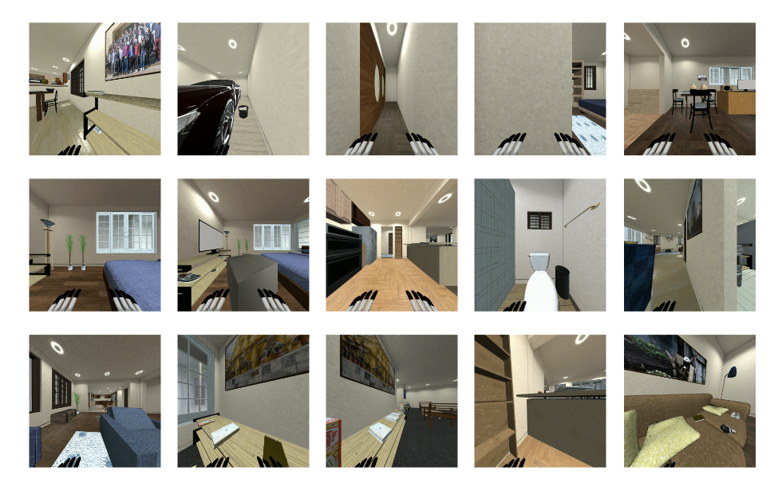
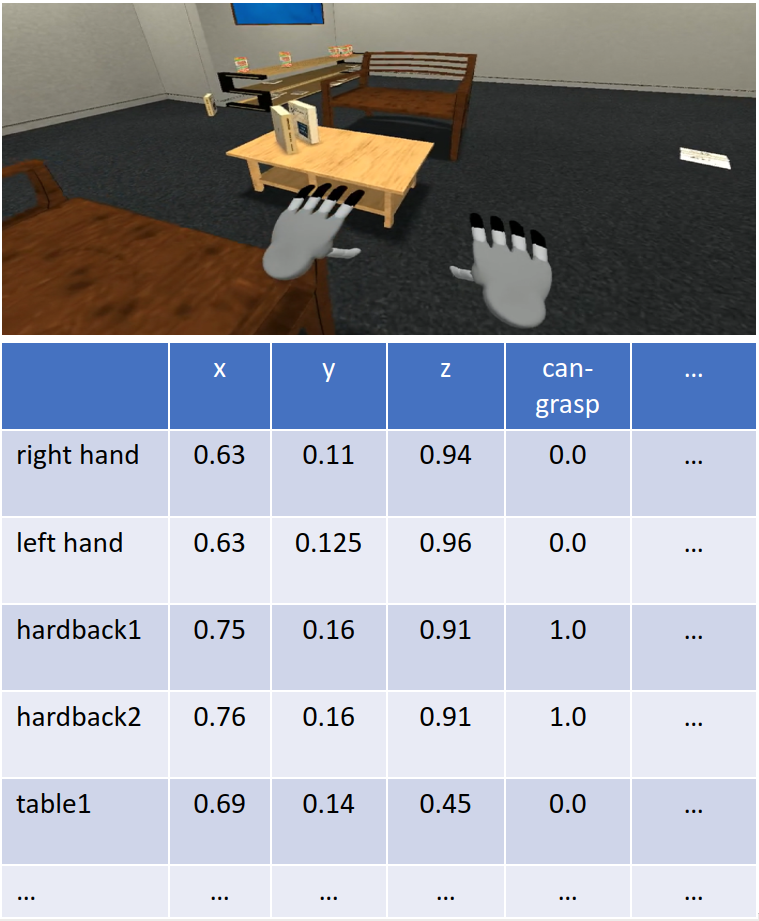
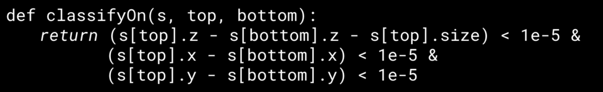
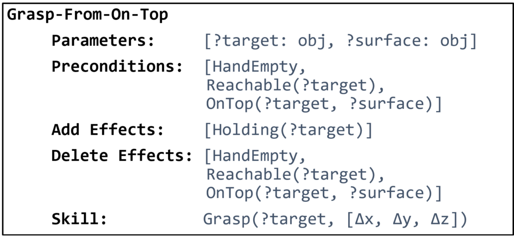
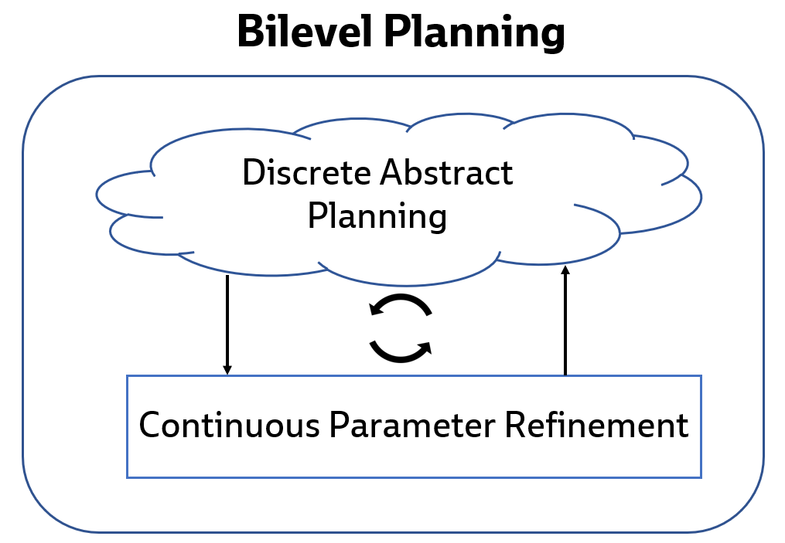
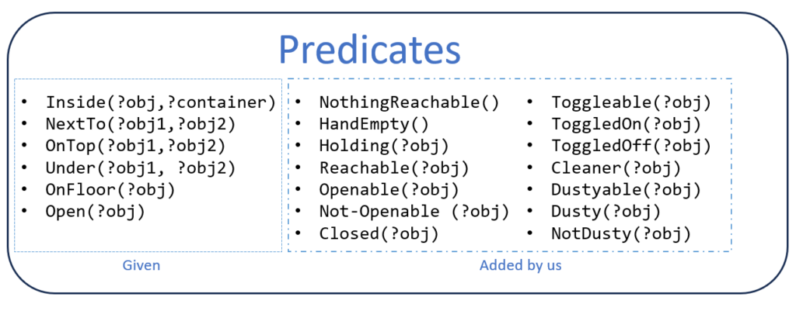
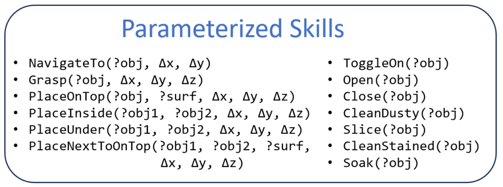
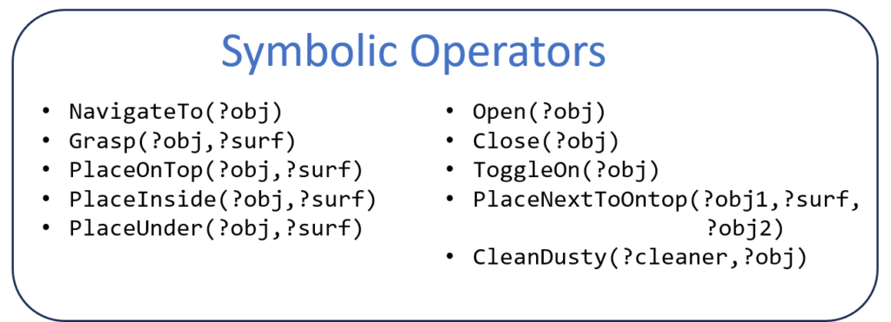
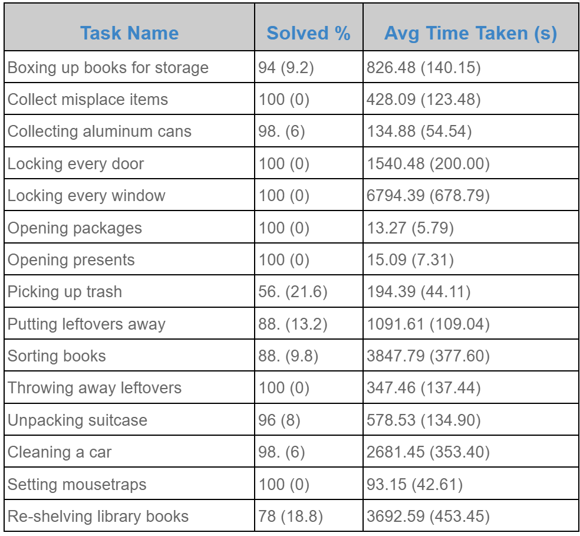

*__Authors’ note__: Our recent work [1, 2, 3, 4, 5, 17] has considered learning models for a form of task and motion planning (TAMP) that we call bilevel planning. Our papers often assume familiarity with bilevel planning and focus on learning. In this blog post, we instead describe bilevel planning from first principles and don’t discuss learning. If you are interested in learning, see our papers from the bibliography below, and stay tuned for a future blog post! Open-source code that implements the ideas discussed here can be found [here](https://github.com/Learning-and-Intelligent-Systems/predicators_behavior) and [here](https://github.com/Learning-and-Intelligent-Systems/predicators).*

## Introduction

A key objective of our research is to develop a generalist robotic agent that can accomplish a very large set of tasks. In a household setting, the robot should respond to commands like “wipe down the kitchen counters” or “put the books on the coffee table into the bookshelf”. The same robot with the same software should be able to achieve these goals in different houses with different cleaning rags, books, and other objects in different locations, and with all manner of variation in the low-level details of the scene. The robot should respond not just to a fixed set of commands, but to a potentially infinite set that varies from house to house: “put away all the books except for the AIMA textbook”, for example.

Given a goal, the robot should start executing after only a moment’s thought, even if it will need hundreds of actions. In other words, the robot should [make good decisions quickly](../2021-03-learning-to-generate-abstractions/). We don’t want a “philosopher robot” that must simulate every possible action, every state stemming from that action, every action after that, and so on. Such a robot would spend all its time thinking and thus never get anything done. We also don’t want a “myopic robot” that immediately starts acting without considering any potential consequences, unless the robot has already memorized the exact right action to take given the current state and goal. Since the space of possible states and goals is vast, and the number of steps required to accomplish goals is large, we will pursue a robot that plans into the future with great focus and efficiency.

There are many techniques which can be used in conjunction for fast robotic planning. One approach is to use heuristics or value functions that are either hand-designed, automatically derived, or learned. AlphaZero [6] is a famous example of the latter. A good heuristic allows the robot to focus its planning effort on future states and actions that are most likely to lead towards good outcomes. Another approach is to use a (goal-conditioned) policy. If the policy is perfect, the robot can use it to select actions without simulating the future at all; otherwise, the policy can still be useful to guide planning [13, 14]. A third approach — the one we focus on in the rest of this blog post — is to use abstractions, particularly state abstractions [3] and action abstractions [1, 5]. A good set of abstractions allows the robot to reason efficiently at a high level before worrying about the low-level details of a task. Thus, a good set of abstractions not only facilitates efficient planning, but also transfers to situations with different low-level details.

In the rest of this post, we describe particular forms of state and action abstractions that have several desirable properties. First, the abstractions are relational, meaning that they deal in relations between objects. As a consequence, the same set of abstractions can be used to solve tasks with different objects. Second, the abstractions are compatible with highly optimized AI planners. This compatibility is one of the main reasons that we will be able to accomplish very long-horizon tasks with very short planning times. Finally, the abstractions can be efficiently learned from relatively small amounts of data. We will not address this last point in this blog post (see [1, 2, 3, 4, 5]), but it remains a key factor in our commitment to these particular kinds of state and action abstractions.

At the end of this post, we will demonstrate how our state and action abstractions together with our bilevel planning framework can yield a single system that is able to solve a variety of tasks and generalize to novel situations from the challenging BEHAVIOR-100 benchmark [7].



<p class="caption"><strong>Figure 1:</strong> An illustration of the visualize diversity of the 15 BEHAVIOR-100 tasks we applied our bilevel planning system to. In order from left to right, top to bottom, the tasks are: <em>(1) Boxing Books Up For Storage, (2) Cleaning A Car, (3) Collecting Aluminum Cans, (4) Locking Every Door, (5) Locking Every Window, (6) Opening A Package, (7) Opening Presents, (8) Putting Leftovers Away, (9) Setting A Mousetrap, (10) Collecting Misplaced Items, (11) Picking Up Trash, (12) Sorting Books, (13) Re-shelving Books, (14) Throwing Away Leftovers, and (15) Unpacking A Suitcase.</em></p>

### A few things before we get started…

Before going further, we want to be clear that the state abstractions, action abstractions, and planning approaches discussed in this post are in no way original to us. The state and action abstractions trace back to seminal work in the 1970s on STRIPS planning with Shakey the Robot at SRI [8]. The action abstractions are also related to the options framework [9] and the connection between options and STRIPS is well-known, especially due to work from George Konidaris [10]. We will discuss bilevel planning, which extends STRIPS-style planning to problems that require integrated discrete and continuous reasoning. Bilevel planning is a simple<a id="ftnt_ref1"></a>[[1]](#ftnt1) form of task and motion planning, which has been studied extensively over the last 10-15 years [12, 15]. All of this is to say: this blog post is meant to be more of a “tutorial” and less of a “paper”.

Now let’s dive in!

## Relational State and Action Abstractions

### Problem Setting

In this post, we will restrict our attention to robotic planning problems that have fully-observed states and deterministic transitions<a id="ftnt_ref2"></a>[[2]](#ftnt2). Full observability means that the robot knows exactly what is going on in its environment at any given time. Even if an object is currently out of the robot’s view, the robot knows about it. Deterministic transitions means that for any state, and for any action that the robot might take in that state, there is exactly one next state that could follow. This assumption rules out the possibility that there is another agent in the environment whose behavior is unpredictable. Robot actions will be continuous vectors, typically representing low-level commands (e.g., joint positions). During planning, we will assume that we have a simulator that accurately predicts what the next state would be if we were to take a hypothetical action.

In addition to supposing that states are fully observed, we will assume that these states are object-centric (i.e. represented by a list of objects each with a set of known features). For example, in a task where books need to be relocated to a bookshelf, the robot would represent each book as an object and itself as an object, and would assign continuous features to each object like “x position”, “y position”, “yaw rotation”, “mass”, “white color component”, and so on. In general, objects can have different types: a robot object can have different features from a book object. For the sake of this blog post, we will assume that this object-centric view is noise-free and readily available. In simulation, this view is straightforward to construct. In reality, we need to perform object (instance) detection, object tracking, and feature detection, and each of these will inevitably involve some amount of error.



<p class="caption"><strong>Figure 2: </strong>A visualization of the object-centric view of the state in a BEHAVIOR environment.</p>

We will also assume in our setting that the robot is equipped with a number of parameterized skills that enable it to modify the environment state. A parameterized skill takes in some set of discrete arguments corresponding to particular objects, and some set of continuous arguments, and then outputs a policy from state to actions that achieves some particular state specified by the parameters. For instance, the parameterized skill ‘`Move(?obj, ?dx, ?dy)`’ takes in discrete argument ‘`?obj`’ and continuous arguments ‘`?dx, ?dy`’ and outputs a policy designed to move the robot base to a position that is (`?dx, ?dy`) away from the center of the object ‘`?obj`’ in the `x` and `y` directions respectively, while orienting the base to face the object in question.

We will want the robot to accomplish many tasks. For our purposes, a task consists of an initial state and a goal. Ultimately, goals will be given by human users<a id="ftnt_ref3"></a>[[3]](#ftnt3). For now however we will assume that goals are represented by a collection of predicates. We will describe predicates in full generality in the next section, but for now, we can continue the book-sorting example: a goal like `{OnTable(b3), On(b2, b3), On(b1, b2)}` uses the `OnTable` and `On` predicates to express that we want “a book stack with b1 on the top, b2 in the middle, and b3 on the bottom.” In an environment like book-sorting, there will be a large task distribution (which includes both different environment distributions, different objects, houses, and initial states, as well as different goal distributions such as ones with many more conditions in the goals). Our objective in designing a planner is to enable the robot to solve tasks from this distribution efficiently and effectively on average.

### State Abstraction with Predicates

A naive way to solve problems from the setting above would be to attempt to plan directly in the object-centric state. Unfortunately, doing this is unlikely to be efficient or effective, since both the object-centric state space, as well as the action space are continuous and potentially extremely high-dimensional. This is especially true if reaching the goal requires a large number of steps. Planning over this space would be akin to a human attempting to plan out the sequence of precise muscle movements they would need to execute in order to cook an entire meal while keeping in mind all objects as well as their features!

To ameliorate this situation, we will abstract our continuous object-centric state space into a discrete space by using predicates. This abstract space will not only be significantly smaller than the continuous space because it will be discretized, but it will also be highly structured. Intuitively, this abstract space will include concepts like ‘`Holding(book1)`’, ‘`On(book1, table)`’, etc. that, as we will see, will make it much easier to think about solving tasks like cooking.

In our context, A predicate has three components: a name, a list of typed arguments, and a classifier. The name can be any string (for instance ‘`OnTop`’, ‘`Holding`’, or ‘`HandEmpty`’). The arguments will be bound to specific object instances of those types (for instance ‘book1’, ‘robot’, or ‘shelf2’). The classifier must be some function that operates on the continuous object-oriented state of objects that are assigned to the typed arguments, and outputs a boolean value.

When particular objects of the correct type are assigned (or bound) to the arguments of a predicate, we say the predicate has become grounded , yielding a ground atom. Given the continuous features of these objects at any time step, the classification function associated with the ground atom can output True or False. Our abstract state will simply be the set of all true ground atoms at that point in time.

<video src="../../media/blog/2023-11-bilevel-planning/behavior-blog-post-image4.mp4" autoplay loop muted playsinline></video>

<p class="caption"><strong>Figure 3</strong>: Illustration of the state abstraction process. Given some low-level state x, we run the classification function of each of our predicates (e.g. OnTable(?block)) on all objects in the state to find the set of ground atoms that are true and comprise our abstract state s.</p>



<p class="caption"><strong>Figure 4</strong>: a pythonic classification function to decide when one object (top) is on top of another (bottom). Here, ‘s’ refers to a continuous state vector and s[top] indexes the state features of the object ‘top’.</p>

### Transition Model Abstraction with Operators and Policies

Our state abstraction as introduced is insufficient on its own to enable abstract planning. This is because we do not yet have actions or a transition model that operate in the abstraction. Both of these will be described in the form of symbolic operators over our predicates.

A symbolic operator consists of six components: a name, typed discrete arguments, preconditions, add effects, delete effects, and an associated parameterized skill. Just as with predicates, the name can be any string (e.g. ‘`Move`’, ‘`PickUp`’,’`PlaceOnTop`’) and the arguments must correspond to specific object types (e.g. ‘`table`’, ‘`chair`’, ‘`floor`’). The preconditions are some set of predicates that represent conditions that all must hold for this operator to be executed. Similarly, the add effects and delete effects are sets of predicates that will be made true and false respectively after the operator has been executed from a state. Additionally, an operator will be associated with one of the available parameterized skills. Just as with predicates, operators are grounded by specifying particular objects for their typed discrete parameters.



<p class="caption"><strong>Figure 5</strong>: Example operator for grasping from atop a surface. The operator has two arguments (both of type ‘obj’): a target object to pick up, and a surface from which to pick this object. The operator’s associated skill is parameterized by the discrete target object, as well as three continuous parameters that correspond to a cartesian position in the object’s coordinate frame at which the robot should attempt to grasp the object..</p>

Recall that we represent an abstract state by the set of true ground atoms in that state. Thus, according to the transition model specified by the operators, given some current abstract state s, the next abstract state s’ after executing ground operator o can be obtained by: `s’ = s ∪ (o.add_effects) \ (o.delete_effects)`, where ‘\’ denotes set difference.

Readers familiar with PDDL will recognize that our symbolic predicates and operators are largely similar to PDDL predicates and operators<a id="ftnt_ref4"></a>[[4]](#ftnt4), where the main difference is the additional parametrized skill. This is no accident: having predicates and operators of this form allows us to leverage powerful domain-independent classical planners to perform search within the abstraction of our problems. In the next section, we will discuss the details of performing this search and shed light on how planning within the abstraction can be connected to planning in our low-level environment.

## Bilevel Planning with Abstractions

### First Attempt: Abstract Planning then Refinement

Given the abstractions in the form of predicates and operators that we have just described, it is now possible to perform abstract, high-level planning to achieve a particular goal.

<video src="../../media/blog/2023-11-bilevel-planning/behavior-blog-post-image5.mp4" autoplay loop muted playsinline></video>

<p class="caption"><strong>Figure 6</strong>: Animated visualization of high-level planning with the provided abstractions. We first abstract our initial low-level state (x0) into an initial high-level state (s0), then use an off-the-shelf AI planning system to come up with a sequence of ground operators that achieve the goal conditions.</p>

We start by converting our initial low-level state into a set of true ground atoms. We do this by running all possible predicate classifiers on the low-level state. We then feed this high-level state and goal into an off-the-shelf classical planning system (such as [Fast Downward](https://www.fast-downward.org/)) to obtain a sequence of ground operators – i.e, an abstract plan – which defines a sequence of sub-goals that achieves the goal from this initial state. Since our abstraction is close to that of PDDL we can leverage powerful planning heuristics for further efficiency.

However, operators are purely an abstraction constructed in the agent’s mind: they cannot be executed in the environment! Fortunately, each ground operator is associated with a parameterized skill which can yield executable actions. However, we must specify a skill’s continuous parameters in order to execute it. Thus, we must introduce another component to our planning algorithm.

### Adding Samplers to Operators

A sampler is a function that takes in some discrete objects, as well as the low-level state, and outputs a distribution to sample continuous parameters from. Specifically, we will associate a sampler with each symbolic operator, and thus the sampler must output a distribution over the continuous parameters of the skill associated with that operator. The contract the sampler makes with the operator is that it should eventually generate values that allow reaching a low-level state that satisfies the operator’s effects.

<video src="../../media/blog/2023-11-bilevel-planning/behavior-blog-post-image7.mp4" autoplay loop muted playsinline></video>

<p class="caption"><strong>Figure 7</strong>: Animated visualization of sampling different continuous parameters for a placement skill. The parameters correspond to an x, y and z offset from the location of the shelf’s center at which to drop the book to see if it lands in a stable setting on the shelf. Note that this sampler is intentionally designed to have high variance for visualization purposes and we do not simulate full arm motion for placement.</p>

Importantly, we want samplers to produce a diverse set of useful continuous parameters. Intuitively, this corresponds to enabling the effects of the associated operators to be accomplished in different ways. For instance, a sampler for a grasping operator might propose a variety of different valid grasps for a particular object, which might be necessary to solve particular tasks. For instance, a hammer needs to be grasped differently depending on if it’s being used to hit or remove a nail, and a cup needs to be grasped differently for pouring or for loading into a dishwasher.

### Downward Refinability

Downward Refinability refers to a property of a hierarchical planning problem in which a feasible solution at the higher level always maps to at least one feasible solution at the lower level. In other words, every decision made at the higher level (our operator choices) has a valid detailed representation or implementation in the lower level (our discrete and continuous parameter choice, as well as skill execution). Now that we have samplers, we can follow a relatively simple process to obtain a sequence of skills that should achieve the goal after execution.

<video src="../../media/blog/2023-11-bilevel-planning/behavior-blog-post-image12.mp4" autoplay loop muted playsinline></video>

<p class="caption"><strong>Figure 8:</strong> Animated visualization of constructing an abstract plan, and then ‘refining’ this plan using samplers (denoted by ∑) to derive the continuous parameters for skill associated with an operator. These skills now have all their parameters specified, so can be executed in the environment in sequence.</p>

As before, we start by abstracting our initial low-level state into a high-level state. We then use a classical planning system to find a plan that takes the agent from this initial state to a state that achieves the goal. For each operator in this plan, we run the associated sampler to find the continuous parameters of the associated skill. Finally, we greedily execute each skill (with these specific continuous parameters passed in) in sequence in the environment.

While this strategy may seem sound at first glance, there is a significant issue. Recall that samplers output a distribution of possible continuous parameters: there is no guarantee that any particular sample from this distribution will yield the desired operator effects! For instance, as can be seen in Figure 3, a sampler for an operator intended to ensure that one of the books is placed onto the shelf might instead drop the book on the floor.

To guard against this failure, we can leverage our simulator to check whether a specific skill with some continuous parameters will achieve some desired effects. Specifically, we can run our abstraction function on the low-level state that results from the skill’s execution and check that the corresponding high-level state matches the expected state in the plan.

<video src="../../media/blog/2023-11-bilevel-planning/behavior-blog-post-image13.mp4" autoplay loop muted playsinline></video>

<p class="caption"><strong>Figure 9</strong>: Animated visualization of sampling multiple different parameters, and checking whether they work. We initially sample parameters that yield a skill that places the book on the floor. Finally, we sample parameters that lead to the book being placed stably on the shelf, as expected by the corresponding ground operator.</p>

Naturally, as in the case illustrated above, this check may not pass depending on the sample. If it fails, we can recover by sampling another value from the distribution returned by the sampler!

<video src="../../media/blog/2023-11-bilevel-planning/behavior-blog-post-image11.mp4" autoplay loop muted playsinline></video>

<p class="caption"><strong>Figure 10</strong>: Animated visualization of constructing an abstract plan, ‘refining’ this plan using samplers (denoted by ∑), and re-trying sampling multiple times until a good sample is found. In this figure, we only retry the first grasp sampler multiple times until we find a good sample, but note that we might have to retry samplers for multiple different actions to find a feasible plan.</p>

Importantly, a failure to find a good sample may actually have occurred because of incorrect sampling on some previous action. Thus, we might need to backtrack, and sample different values for previous actions before the current failing action in our plan. In the scenario depicted in Figure 10, consider that the first move sampler might have yielded a position that is just behind the chair. Thus, the agent is blocked from grasping the book by the chair, and there is no feasible grasp sample from this position. We will have to backtrack and sample an entirely new location to move to in order to enable the grasp sampler to eventually yield a good sample.

Of course, it may be the case that even after attempting to backtrack significantly, we are unable to find a set of satisfactory parameters that fulfill the high-level states from our abstract plan. In this case, we might need to request an entirely new abstract plan from the classical planner.

<video src="../../media/blog/2023-11-bilevel-planning/behavior-blog-post-image14.mp4" autoplay loop muted playsinline></video>

<p class="caption"><strong>Figure 11</strong>: Animated visualization of backtracking requiring a completely new abstract plan. Initially, the agent comes up with a plan to directly place the books it is holding onto the shelf. However, the shelf is cluttered and thus, no sample for placing works. After trying a few samples, the agent comes up with a new plan that first clears the surface of the shelf before attempting to place things.</p>

Backtracking to sample new continuous parameters, and even entirely new abstract plans, is often the most computationally expensive and slow part of bilevel planning. In fact, a lot of work that human designers put into constructing predicates, operators, and samplers, is done to minimize backtracking as much as possible. Studying backtracking and attempting to minimize the need for it is also an active area of research.

### Summary of Bilevel Planning



<p class="caption"><strong>Figure 12</strong>: A high-level overview figure visualizing the main hierarchy in bilevel planning.</p>

In summary, bilevel planning can be thought of as consisting of two nested loops:

- Outer loop: search for abstract plans with symbolic predicates and operators
- Inner loop: refinement of abstract plans into ground skills using samplers

Intuitively, the outer loop solves the discrete problem of sequencing together skills (e.g. in order to place an object somewhere, the robot must first pick it up, which requires moving to it), while the inner loop solves the continuous problem of refining these skills with the precise parameters necessary to ensure their intended effects hold. Breaking the problem down this way provides leverage so that bilevel planning can be far more efficient than attempting to solve the entire problem in a monolithic fashion.

Now that we have discussed what bilevel planning is, we turn to a case study of what it can do.

## Solving BEHAVIOR-100 Tasks with Bilevel Planning

BEHAVIOR-100 [7] is a recent benchmark of 100 robotic tasks simulated in a variety of different household environments<a id="ftnt_ref5"></a>[[5]](#ftnt5). The tasks themselves are intended to be representative of things that a user might ask of a household robot, such as “put away all the books” or “make a cup of tea”. Solving even a single one of these tasks is extremely challenging because they often require a large number of steps (i.e, they are long-horizon) and must be performed in a variety of different simulated homes.

Despite its challenging nature, BEHAVIOR-100 offers all the necessary ingredients for us to run bilevel planning on it. The simulation is deterministic and offers access to all properties of all the objects in the environment, which we can use to construct our fully-observable object-oriented low-level state. Moreover, the benchmark comes with a few skills already implemented, and extending this set to include more parameterized skills is not particularly difficult<a id="ftnt_ref6"></a>[[6]](#ftnt6).

In an effort to test the capability and generalizability of a bilevel planning system, we decided to manually implement skills, predicates and operators for bilevel planning in BEHAVIOR-100. Importantly, we wanted to implement a single system capable of generalizing across the entire benchmark: i.e., a single set of the various necessary components that could support bilevel planning to any goal in the benchmark, from any possible initial state in any house.

### Skills, Predicates, and Operators

We manually implemented 13 parameterized skills, 24 predicates, and 13 symbolic operators. Together with the 6 predicates already provided with BEHAVIOR-100 (Inside, NextTo, OnTop, Under, OnFloor, Open), this amounts to a total of 13 skills, 30 predicates, and 13 operators. The specifics of these components are displayed in the figures below.



<p class="caption"><strong>Figure 13</strong>: All predicates that our bilevel planning system has access to. Of these 20 predicates, 6 were directly provided by BEHAVIOR-100, and 14 were additionally implemented by us, as indicated. See <a href="https://github.com/Learning-and-Intelligent-Systems/predicators_behavior/blob/365bc9e38e8a38395980deb8ee04febc54540d7b/predicators/envs/behavior.py#L754">this file</a> for implementation details.</p>



<p class="caption"><strong>Figure 14</strong>: Parameterized skills that we implemented to enable our bilevel planning system to operate on BEHAVIOR-100 tasks. See <a href="https://github.com/Learning-and-Intelligent-Systems/predicators_behavior/blob/365bc9e38e8a38395980deb8ee04febc54540d7b/predicators/behavior_utils/option_fns.py#L46">this file</a> for implementation details.</p>



<p class="caption"><strong>Figure 15</strong>: All operators that our bilevel planning system has access to. Not shown: each of these operators has (1) preconditions and effects defined in terms of predicates, (2)  a corresponding handwritten sampler, and (3) a corresponding parameterized skill. Implementation details can be <a href="https://github.com/Learning-and-Intelligent-Systems/predicators_behavior/blob/365bc9e38e8a38395980deb8ee04febc54540d7b/predicators/ground_truth_nsrts.py#L3095">found here</a>.</p>

### Results



<p class="caption"><strong>Table 1: </strong>All tasks solved with success percentage, average wall clock test time, and number of nodes created when searching for a task plan. For all numerical columns, the standard deviation is listed in parentheses.</p>

<video src="../../media/blog/2023-11-bilevel-planning/results-opening-packages-short-1.mp4" autoplay loop muted playsinline></video>

<video src="../../media/blog/2023-11-bilevel-planning/results-throwing-away-leftovers-faster.mp4" autoplay loop muted playsinline></video>

<video src="../../media/blog/2023-11-bilevel-planning/results-collecting-cans-shorter.mp4" autoplay loop muted playsinline></video>

**Figure 16:** A visualization of our Bilevel Planner during execution (with simulated grasping and placing) on a few other tasks: *Opening Packages (left), Throwing Away Leftovers (middle), and Collecting Aluminum Cans (right)*.

As shown in the figure, our system is able to solve ~15 tasks from the benchmark with a >50% success rate under timeout. Notably, most tasks display a >90% success rate, while very few are between 50% and 90%. We observed that these few tasks often had certain initial states that made accomplishing the task significantly more challenging than from other initial states (e.g. a cluttered shelf that was very difficult to place onto), leading to a significant amount of time spent backtracking by our approach.

While we have not yet solved all 100 tasks from BEHAVIOR-100 with bilevel planning, this seems attainable by simply continuing the process of adding skills, samplers, predicates and operators! It will be noteworthy and interesting to see how many more of these various components will be required to robustly solve all tasks in the benchmark, and whether the framework breaks down or becomes extremely inefficient as more of these components are implemented.

## Conclusion

Bilevel planning is a rather simple framework for solving long-horizon robotic tasks. At its core, it separates decision making into two levels: sequencing together some discrete set of skills, and then refining those skills into executable trajectories via continuous sampling. Despite its simplicity, it is capable of generalizing to a large variety of realistic tasks (different houses, objects, and goal compositions), as we have demonstrated on a subset of the BEHAVIOR-100 benchmark.

Importantly however, bilevel planning is no silver bullet capable of solving all robotics tasks. It requires a number of particular ingredients (predicates, operators, good symbolic planners, samplers, etc.), that can be hard to write down or learn. Moreover, it requires an accurate, low-level simulator that predicts entire world states given an action, which is often especially difficult for real-world tasks. It can be rather slow due to backtracking in problems where there are extremely long horizon dependencies in the decision-making (i.e. an action performed at a very early time step in the plan is crucial to the success of an action performed tens or even hundreds of steps later in the plan). While these are challenging problems to overcome, learning has shown promise in helping in these areas [1, 2, 3, 4, 5, 17]<a id="ftnt_ref7"></a>[[7]](#ftnt7).

We hope that by providing an approachable overview of bilevel planning, we can inspire future research that leverages bilevel planning, TAMP, or even just the core ideas and intuitions around hierarchy and abstraction from these frameworks to build truly general-purpose robotic systems.

## Acknowledgements

We thank Leslie Kaelbling, Tomás Lozano-Pérez, and Jorge Mendez for detailed comments and insightful discussion on earlier drafts of this post.

## Citation

If this blog post has been useful for your work, consider citing us!

**APA**

Nishanth Kumar, Willie McClinton, Kathryn Le, & Tom Silver (2023). Bilevel Planning for Robots: An Illustrated Introduction. Learning and Intelligent Systems Group Website. https://lis.csail.mit.edu/blog/2023-11-bilevel-planning/

**Bibtex**

```
@article{bilevel-planning-blog-post,
  author    = {Nishanth Kumar and Willie McClinton and Kathryn Le and Tom Silver},
  title     = {Bilevel Planning for Robots: An Illustrated Introduction},
  note      = {https://lis.csail.mit.edu/blog/2023-11-bilevel-planning/},
  year      = {2023}}
```

## Bibliography

[1] Silver, T., Chitnis, R., Tenenbaum, J. B., Kaelbling, L. P., & Lozano-Pérez, T. (2021). Learning Symbolic Operators for Task and Motion Planning. In IEEE/RSJ International Conference on Intelligent Robots and Systems (IROS).

[2] Silver, T., Athalye A., Tenenbaum J. B., Lozano-Pérez, T., & Kaelbling, L. P. (2022). Learning Neuro-Symbolic Skills for Bilevel Planning. In Conference on Robot Learning (CoRL).

[3] Silver, T., Chitnis, R., Kumar, N., McClinton, W., Lozano-Pérez T., Kaelbling, L. P., & Tenenbaum, J. B. (2023). Predicate Invention for Bilevel Planning. In AAAI Conference on Artificial Intelligence (AAAI).

[4] Amber Li, & Tom Silver (2023). Embodied active learning of relational state abstractions for bilevel planning. In Conference on Lifelong Learning Agents (CoLLAs).

[5] Kumar, N., McClinton, W., Chitnis, R., Silver, T., Lozano-Pérez, T., & Kaelbling, L.P., (2023). Learning Efficient Abstract Planning Models that Choose What to Predict. In Conference on Robot Learning (CoRL).

[6] Silver, D., Hubert, T., Schrittwieser, J., Antonoglou, I., Lai, M., Guez, A., … & Hassabis, D. (2018). Mastering chess and shogi by self-play with a general reinforcement learning algorithm. Science.

[7] Srivastava, S., Li, C., Lingelbach, M., Martín-Martín, R., Xia, F., Vainio, K.E., Lian, Z., Gokmen, C., Buch, S., Liu, K., Savarese, S., Gweon, H., Wu, J. &amp; Fei-Fei, L.. (2022). BEHAVIOR: Benchmark for Everyday Household Activities in Virtual, Interactive, and Ecological Environments. Conference on Robot Learning.

[8] Nilsson, N.J. (1984). Shakey the Robot.

[9] Sutton, R. S., Precup, D., & Singh, S. (1999). Between MDPs and semi-MDPs: A framework for temporal abstraction in reinforcement learning. Artificial intelligence.

[10] Konidaris, G., Kaelbling, L. P., & Lozano-Pérez, T. (2018). From skills to symbols: Learning symbolic representations for abstract high-level planning. Journal of Artificial Intelligence Research.

[11] Asai, M., & Fukunaga, A. (2018). Classical planning in deep latent space: Bridging the subsymbolic-symbolic boundary. In AAAI.

[12] Garrett, C. R., Chitnis, R., Holladay, R., Kim, B., Silver, T., Kaelbling, L. P., & Lozano-Pérez, T. (2021). Integrated task and motion planning. Annual review of control, robotics, and autonomous systems.

[13] Schaul, T., Horgan, D., Karol, G., & Silver, D. (2015). Universal Value Function Approximators. Journal of Machine Learning Research.

[14] Yoon, S., Fern, Alan., & Givan, Robert. (2008). Learning Control Knowledge for Forward Search Planning. Journal of Machine Learning Research.

[15] Gravot, F., Cambon, S., Alami, R. (2005). aSyMov: A Planner That Deals with Intricate Symbolic and Geometric Problems. Springer Tracts in Advanced Robotics.

[16] Xie, Y., Yu, C., Zhu, T., Bai, J., Gong, Z., & Soh, H. (2023). Translating natural language to planning goals with large-language models. arXiv preprint arXiv:2302.05128.

[17] Chitnis, R., Silver, T., Tenenbaum, J. B., Lozano-Pérez, T., & Kaelbling, L. P. (2022). Learning Neuro-Symbolic Relational Transition Models for Bilevel Planning. In IEEE/RSJ International Conference on Intelligent Robots and Systems (IROS).

---

---

<a id="ftnt1"></a>[[1]](#ftnt_ref1) From a TAMP perspective, bilevel planning is simple for two reasons: the generation of abstract plans is relatively naive, and the sampling schedule for each abstract plan is also naive. Although potentially less computationally efficient, the simplicity of the bilevel approach makes it easier to study abstraction learning [1, 2, 3, 4, 5].

<a id="ftnt2"></a>[[2]](#ftnt_ref2) These assumptions can be relaxed, but to keep things simple, we will stick to assuming them.

<a id="ftnt3"></a>[[3]](#ftnt_ref3) For instance, [16] shows that large language models are rather capable at translating natural language commands into a set of predicates.

<a id="ftnt4"></a>[[4]](#ftnt_ref4) The specific subset of PDDL we use is STRIPS, along with support for quantification in effects.

<a id="ftnt5"></a>[[5]](#ftnt_ref5) The authors of the benchmark have recently extended it to 1000 tasks with the [BEHAVIOR-1000](https://behavior.stanford.edu/behavior-1k) challenge!

<a id="ftnt6"></a>[[6]](#ftnt_ref6) Note that while BEHAVIOR-100 is ultimately intended to be solved from partially-observable vision data, solving it assuming full-observability and object-oriented state is still extremely challenging. The original authors [7] discovered that most contemporary approaches struggle in this domain despite these simplifications.

<a id="ftnt7"></a>[[7]](#ftnt_ref7) [5] in particular shows that symbolic operators can be learned for BEHAVIOR-100 tasks from just 10 demonstrations!
